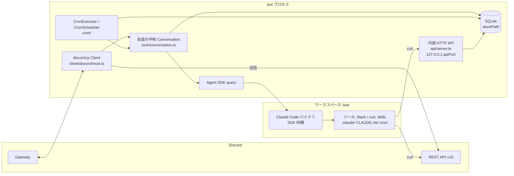

# アーキテクチャ

loms-claw の現状のアーキテクチャを章立てで記述する正本。構成の把握に必要な全体像 (目的・技術スタック・システムコンテキスト・モジュール依存・ファイル構成) と各章への索引をこのファイルに置き、個々の仕組みは各章に分ける。ルート [CLAUDE.md](../../CLAUDE.md) は不変条件・規約・索引に絞り、仕組みの記述はこのディレクトリを参照する。記述はソースコードを正とし、コードと食い違う場合はコードが優先する。

関連: [利用規約に関する注意](../terms-of-service.md)/[内部 API 定義](../api/README.md)/[CLAUDE.md](../../CLAUDE.md)/[エージェント向け指示書](../../data/workspace/CLAUDE.md)

## 目的

Discord の単一ギルド・単一ユーザ専用のパーソナル AI エージェント。Discord のメッセージや定期実行 (cron) を起点に Claude Agent SDK の `query()` を呼び出し、SDK 同梱の Claude Code バイナリをエージェントワークスペース上で動かして結果を Discord に返す。

利用規約上の根拠と経緯は [docs/terms-of-service.md](../terms-of-service.md) にまとめている。実装時に守る不変条件は次の 2 点である。

- `client/discord/guard.ts` の `isAuthorized()` による単一ギルド ID・単一ユーザ ID (サブスクリプション購入者本人) との完全一致要求を崩さない。bot 自身の投稿による起動は `isAuthorizedSelfMessage()` で別途判定するが、同一ギルド内の自 bot の投稿に限られ、第三者のリクエストが流入する経路にはならない。
- cron による自動実行の頻度・規模を「個人の通常利用」の範囲に保つ。

## 技術スタック

`package.json` の `dependencies` から。

| 技術                               | 用途                                                                                                                                                 |
| ---------------------------------- | ---------------------------------------------------------------------------------------------------------------------------------------------------- |
| Node.js 26                         | ランタイム。TypeScript は型除去で直接実行する (`node main.ts`)                                                                                       |
| discord.js v14                     | Discord Gateway への接続、メッセージ受信、ボタン / select menu / Modal、スラッシュコマンド登録                                                       |
| `@anthropic-ai/claude-agent-sdk`   | `query()` による Claude 呼び出し。同梱の Claude Code バイナリを SDK が spawn する                                                                    |
| Hono (`hono`, `@hono/node-server`) | 内部 HTTP API (`127.0.0.1:{apiPort}`)                                                                                                                |
| SQLite (`node:sqlite`)             | スコープ単位の設定・セッション ID の永続化 (`storePath`、`settings` テーブル)                                                                        |
| `@js-temporal/polyfill`            | `Temporal`。cron のタイムゾーン付き時刻の受け渡し (`cron/match.ts`)、レートリミッタの時刻計算 (`core/ratelimit.ts`)。Node が組み込みで提供したら外す |
| `croner`                           | cron 式のパースと一致判定 (`cron/match.ts`)                                                                                                          |
| `@cfworker/json-schema`            | `config.json`・内部 API リクエストボディ・cron frontmatter の構造検証                                                                                |
| `json-schema-to-ts`                | 内部 API の schema から TypeScript 型を導出 (`FromSchema`)                                                                                           |
| `@std/front-matter`, `@std/yaml`   | cron ジョブファイルの YAML frontmatter 抽出とパース                                                                                                  |
| `@std/path`                        | パス操作                                                                                                                                             |

コンテナイメージ (`Dockerfile`) には `curl`/`jq` (Discord REST を叩く skill 用)、`ffmpeg` (添付画像のリサイズ、`client/discord/message.ts` の `resizeImageIfNeeded()`)、`git`/`bubblewrap`/`socat` が同梱される。

## システムコンテキスト

- bot プロセスは discord.js の `Client` で Gateway に接続し、`messageCreate`/`interactionCreate` を受ける (`client/discord/mod.ts` の `DiscordBot`)。応答・承認ボタン・cron 結果の投稿は同じ Client から送る。キュー・セッション・ストリーム消費といった会話の中核は discord.js に依存しない `core/conversation.ts` (`Conversation`) が担い、`client/discord/` はその入出力のアダプタである。
- Claude 呼び出しは `core/conversation.ts` が `claude/mod.ts` の `askClaude()` 経由で Agent SDK の `query()` を呼ぶ。`cwd` はプロセス起動時の `process.cwd()` (`config.ts` の `loadConfig()` が `claude.cwd` として注入)。本番では `/data/workspace`、devcontainer ではソースリポジトリ自身になる。
- Claude 側からの Discord 操作は bot プロセスを経由せず、SDK 同梱バイナリが spawn する Bash + curl で Discord REST API を直接叩く。bot トークンは Discord 側 (`client/discord/mod.ts`) が `ConversationDeps.env` / `CronExecutorOptions.env` に `{ DISCORD_BOT_TOKEN }` を渡し、`claude/mod.ts` の `buildQueryOptions()` が `query()` の `env` へ重ねる。
- 内部 HTTP API は cron 操作・ログ取得・スコープ設定の操作を `127.0.0.1` に提供し、Claude から curl で呼ばれる。ツール承認は in-process (`canUseTool` コールバック) で、HTTP では扱わない。
- 永続化は SQLite 1 ファイル (`config.json` の `storePath`) のみ。`main.ts` が open し、`Store` (`store/mod.ts`) 経由で bot/cron/API が共有する。

## モジュール依存と層構造

`import ... from` をソースから抽出した依存グラフ。`logger.ts` と `errors.ts` はほぼ全モジュールから参照される横断ユーティリティのため辺を省略している。点線は型のみの import (`import type`)。

```mermaid
graph TD
  main[main.ts]
  config[config.ts]
  schema[config.schema.ts]
  schemajson[config.schema.json]
  botmod[client/discord/mod.ts]
  commands[client/discord/commands.ts]
  guard[client/discord/guard.ts]
  incoming[client/discord/incoming.ts]
  message[client/discord/message.ts]
  turnoutput[client/discord/turn-output.ts]
  conversation[core/conversation.ts]
  queue[core/queue.ts]
  ratelimit[core/ratelimit.ts]
  flush[core/flush.ts]
  scope[client/discord/scope.ts]
  crontarget[client/discord/cron-target.ts]
  claude[claude/mod.ts]
  sysprompt[claude/system-prompt.ts]
  template[claude/template.ts]
  store[store/mod.ts]
  approval[client/discord/approval/manager.ts]
  question[client/discord/approval/question.ts]
  asettings[core/approval-settings.ts]
  aconstants[client/discord/approval/constants.ts]
  server[api/server.ts]
  rcron[api/routes/cron.ts]
  rhealth[api/routes/health.ts]
  rlogs[api/routes/logs.ts]
  rsettings[api/routes/settings.ts]
  validate[api/validate.ts]
  ischemas[api/internal-schemas.ts]
  executor[cron/executor.ts]
  loader[cron/loader.ts]
  scheduler[cron/scheduler.ts]
  match[cron/match.ts]
  ctypes[cron/types.ts]

  main --> config
  main --> botmod
  main --> store
  config --> schema
  schema --> schemajson

  botmod -.-> config
  botmod --> sysprompt
  botmod -.-> store
  botmod --> approval
  botmod --> commands
  botmod --> guard
  botmod --> incoming
  incoming -.-> config
  incoming -.-> store
  incoming --> guard
  incoming --> scope
  botmod --> conversation
  botmod --> ratelimit
  botmod --> message
  botmod --> turnoutput
  turnoutput -.-> conversation
  turnoutput --> message
  botmod --> crontarget
  botmod --> server
  botmod -.-> rcron
  botmod -.-> rsettings
  botmod -.-> rhealth
  botmod --> executor
  botmod --> loader

  crontarget -.-> executor
  crontarget --> approval
  crontarget --> message

  conversation --> claude
  conversation -.-> sysprompt
  conversation -.-> store
  conversation -.-> config
  conversation --> queue
  conversation --> flush
  conversation -.-> ratelimit

  commands -.-> config
  commands -.-> executor
  commands -.-> store
  commands --> guard
  commands --> scope
  guard -.-> config

  claude -.-> config
  sysprompt --> template

  approval --> asettings
  approval --> question
  question --> message
  approval --> aconstants
  question --> aconstants

  server --> rcron
  server --> rhealth
  server --> rlogs
  server --> rsettings
  rcron -.-> ctypes
  rcron -.-> ischemas
  rcron --> validate
  rsettings -.-> store
  rsettings -.-> ischemas
  rsettings --> validate
  validate --> ischemas

  executor --> conversation
  executor -.-> claude
  executor -.-> config
  executor -.-> store
  executor -.-> sysprompt
  executor --> scheduler
  executor -.-> ctypes
  loader --> match
  loader -.-> ctypes
  loader --> claude
  scheduler --> match
  scheduler -.-> ctypes
```

層として読むと次のようになる。依存は client → core の一方向で、`core/` は discord.js にも `client/` にも依存しない。この規則は `.oxlintrc.json` の `no-restricted-imports` で検査する (`client/discord/` 以外では `discord.js` を import できず、`client/` は `client/` 自身と `main.ts` 以外から import できない)。ファイル単位の循環依存は無く、ディレクトリ単位でも `client/discord/mod.ts → client/discord/approval/manager.ts` と `client/discord/approval/question.ts → client/discord/message.ts` (`DISCORD_MESSAGE_LIMIT` の共有) はどちらも `client/discord/` の内側に収まる。

| 層           | モジュール                                                                      | 役割                                                                                                                               |
| ------------ | ------------------------------------------------------------------------------- | ---------------------------------------------------------------------------------------------------------------------------------- |
| エントリ     | `main.ts`                                                                       | 設定読込 → ロガー初期化 → ストア open → `DiscordBot` 起動 (リトライ付き)                                                           |
| 合成ルート   | `client/discord/mod.ts`                                                         | 全サブシステムを生成・接続する唯一の場所                                                                                           |
| client       | `client/discord/*` (mod 以外), `client/discord/approval/*`                      | Discord 入出力のアダプタ。discord.js に依存してよいのはこの層だけ。`core/` の `TurnOutput` と `cron/` の `CronPorts` を実装する    |
| 中核         | `core/*`                                                                        | 会話の中核 (`Conversation`)・直列キュー・レート制限・フラッシュ分割・承認設定。discord.js 非依存                                   |
| サブシステム | `claude/*`, `store/mod.ts`, `api/*`, `cron/*`                                   | 各ディレクトリが 1 つの関心事を担う。ディレクトリをまたぐ参照は次の例外のみ                                                        |
| 横断基盤     | `config.ts`, `config.schema.ts`, `config.schema.json`, `logger.ts`, `errors.ts` | 設定・ログ・エラー整形。サブシステムに依存しない (内部では `config.ts` → `config.schema.ts` / `errors.ts` / `logger.ts` (型) のみ) |

ディレクトリをまたぐ辺は次に限られる。

- `client/discord/*` → `core/*`: `DiscordBot` が `Conversation` を生成して `submit()` を呼び、`client/discord/turn-output.ts` の `createTurnOutput()` で組み立てた `TurnOutput` を渡す。`SelfMentionRateLimiter` と `core/approval-settings.ts` も core 側にある
- `core/conversation.ts` → `claude/mod.ts`, `claude/system-prompt.ts` (型), `store/mod.ts` (型), `config.ts` (型): 会話の 1 ターンで Claude を呼び、セッション・設定を扱うため
- `cron/executor.ts` → `core/conversation.ts` (`runOneShot`), `claude/system-prompt.ts` (型), `store/mod.ts` (型): cron の prompt ジョブも中核の `runOneShot()` で Claude を呼ぶ (`ScopeQueue` は通さない)
- `client/discord/cron-target.ts` → `cron/executor.ts` (型のみ): `CronPorts` を Discord で実装する
- `cron/loader.ts` → `claude/mod.ts` (`EFFORT_LEVELS`): frontmatter の `effort` 検証に effort の定義を共有
- `client/discord/commands.ts` → `cron/executor.ts` (型のみ)
- `api/routes/*` → `store/mod.ts` (型), `cron/types.ts` (型): API は実体を `client/discord/mod.ts` から `CronRouteContext`/`SettingsRouteContext` として注入される

`TurnOutput` と `CronPorts` は「依存される側が口を定義し、client が実装する」形の境界である。`TurnOutput` は 1 ターンで外へ出る呼び出し (待機表示・typing・添付の取り込み・応答/thinking の送信・進捗・エラー通知・後始末) を中核の呼び出し順どおりに並べたライフサイクル付きメソッド群、`CronPorts` は cron が client に求める 3 操作 (送信先の解決・ギルド由来のテンプレート変数・承認コールバックの生成) である。汎用 client API は用意しない。詳細は [message-flow.md](message-flow.md) と [cron.md](cron.md)。

## ディレクトリ / ファイル構成

`git ls-files` で確認した構成。テストは各モジュールと同じディレクトリに `*.test.ts` として置く。

### ルート

| パス                  | 役割                                                                                                                                                                                                                                                                                    |
| --------------------- | --------------------------------------------------------------------------------------------------------------------------------------------------------------------------------------------------------------------------------------------------------------------------------------- |
| `main.ts`             | エントリポイント。`loadConfig()` → `initLogger()` → `new DatabaseSync()` (`node:sqlite`) → `new DiscordBot().start()`。指数バックオフで最大 5 回リトライ。SIGINT / SIGTERM で `shutdown()`                                                                                              |
| `config.ts`           | `config.json` → `Config` 型。`LOMS_CLAW_CONFIG` でパス変更可 (既定 `./data/config.json`)。`claude.cwd` に `process.cwd()` を注入                                                                                                                                                        |
| `config.schema.json`  | 設定の JSON Schema 本体。`config.json` 側で `$schema` として参照すれば IDE 補完が効く                                                                                                                                                                                                   |
| `config.schema.ts`    | `@cfworker/json-schema` の `Validator` で検証。`applyConfigDefaults()` が schema の `default` を補完                                                                                                                                                                                    |
| `logger.ts`           | 名前空間付きロガー。`initLogger()` / `createLogger()` / `getLogEntries()`。リングバッファで直近ログを保持                                                                                                                                                                               |
| `errors.ts`           | `getErrorMessage()`: unknown なエラー値からメッセージを取り出す。`summarizeError()`: 通知向けの 1 行要約。`isNotFoundError()`: ENOENT 判定                                                                                                                                              |
| `test-helpers.ts`     | テスト用ヘルパ。`errorWith()`: `assert.throws` / `assert.rejects` 向けにエラークラスと message 部分一致を検証する validator を返す (カバレッジ対象外)                                                                                                                                   |
| `package.json`        | 依存と scripts (`start` / `dev` / `test` / `check` / `lint` / `fix` / `generate`)。`package-lock.json` が lockfile、`.npmrc` が `@std/*` を取る JSR 互換レジストリの設定                                                                                                                |
| `tsconfig.json`       | `tsc --noEmit` の設定 (`check` タスク)。`erasableSyntaxOnly` で Node の型除去が受け付けない構文を検出する。`types` は `node`                                                                                                                                                            |
| `.oxlintrc.json`      | oxlint 設定 (`lint` / `fix` タスク)。`curly` を error にし、`discord.js` の import を `client/discord/` に閉じ込める `no-restricted-imports` (`client/` は `client/` 自身と `main.ts` 以外から import 禁止) を設定し、`data/`, `docs/api`, `api/internal-schemas.ts`, `.claude/` を除外 |
| `.oxfmtrc.json`       | oxfmt 設定 (`lint` / `fix` タスク)。`data/`, `docs/api`, `api/internal-schemas.ts`, `.claude/`, `.github/workflows/`, YAML 全般を除外                                                                                                                                                   |
| `Dockerfile`          | `node:26-bookworm-slim` ベース。`CLAUDE_CONFIG_DIR` / `LOMS_CLAW_CONFIG` を `ENV` で宣言。SDK 同梱 Claude Code を `/usr/local/bin/claude` に symlink。`WORKDIR /data/workspace`                                                                                                         |
| `compose.yaml`        | 本番サービス定義。`./data` を `/data` に bind mount (マウントはこの 1 つ)。`TZ` を `.env` から渡す                                                                                                                                                                                      |
| `.devcontainer/`      | 開発コンテナ定義。`compose.yaml` にソースの `/app` bind mount を重ねる                                                                                                                                                                                                                  |
| `.github/`            | `dependabot.yml` (npm はルートと `docs/api` の 2 エントリ、加えて docker / github-actions)、`workflows/ci.yml` (Node 26 の `root` / `generated` / `docs-api`)、`workflows/claude.yml` (issue / PR コメントの `@claude` で起動する Claude Code Action)                                   |
| `.claude/rules/pr.md` | PR 作成前の検証チェーン (`npm run fix && npm run check && npm run lint && npm test`)                                                                                                                                                                                                    |
| `.worktreeinclude`    | worktree 作成時にメイン worktree から複製するローカル資産 (`.env`, `data/config.json`, `data/home/`, `data/workspace/`)                                                                                                                                                                 |
| `.env.example`        | docker compose が host 側で読む変数 (`TZ` のみ)                                                                                                                                                                                                                                         |
| `LICENSE`             | MIT License                                                                                                                                                                                                                                                                             |
| `CLAUDE.md`           | 開発者・エージェント向けのプロジェクト指示 (不変条件・規約・索引)                                                                                                                                                                                                                       |

### `core/` — 会話の中核 (discord.js 非依存)

| パス                        | 役割                                                                                                                                                                                                       |
| --------------------------- | ---------------------------------------------------------------------------------------------------------------------------------------------------------------------------------------------------------- |
| `core/conversation.ts`      | `Conversation`: scope 単位の直列キュー → セッション・設定の取得 → システムプロンプト解決 → `askClaude()` → ストリーム消費。出力先 IF `TurnOutput`、入力 `TurnInput`、cron 用の `runOneShot()` もここで定義 |
| `core/queue.ts`             | `ScopeQueue`: scope 単位でターンを直列化                                                                                                                                                                   |
| `core/ratelimit.ts`         | `SelfMentionRateLimiter`: 自己メンション応答のスライディングウィンドウレート制限 (bot 全体、Temporal ベース)                                                                                               |
| `core/flush.ts`             | `splitAtBoundary()`: 文境界 (`。` / 改行) でのバッファ分割アルゴリズム。`Conversation` の回答・thinking のフラッシュが共有する純粋関数                                                                     |
| `core/approval-settings.ts` | `isInAllowList()` / `addToSettingsAllowList()`: ワークスペースの `.claude/settings.json` の `permissions.allow` 読み書き                                                                                   |

### `client/discord/` — Discord アダプタ

| パス                                   | 役割                                                                                                                                                                                                                                                                                                                               |
| -------------------------------------- | ---------------------------------------------------------------------------------------------------------------------------------------------------------------------------------------------------------------------------------------------------------------------------------------------------------------------------------- |
| `client/discord/mod.ts`                | `DiscordBot` クラス。`messageCreate` / `interactionCreate` ハンドラ、`start()` (ClientReady 後にコマンド登録 → cron 初期化 → API サーバ起動)、`shutdown()`。`onMessage` は入力の組み立て (発話者・テンプレート変数は `turn-output.ts` の関数) と `TurnOutput` の生成 (`createTurnOutput()`) を呼び、`Conversation.submit()` を呼ぶ |
| `client/discord/commands.ts`           | スラッシュコマンド `/claw settings show\|set\|unset` の定義とハンドラ。`set` は model / effort / show_thinking / active、`unset` はそれに session を加えた対象を取る                                                                                                                                                               |
| `client/discord/guard.ts`              | `isAuthorized()` (ギルド + ユーザ + bot 除外)、`resolveActive()`、`shouldRespond()`、`isAuthorizedSelfMessage()` (AI to AI 自己メンション)                                                                                                                                                                                         |
| `client/discord/message.ts`            | `splitMessage()`、`keepTyping()`、`createProgressReporter()`、`stripBotMentions()`、画像添付の取得・リサイズ・後始末 (`downloadImageAttachments()` / `resizeImageIfNeeded()` / `appendImageReferences()` / `cleanupImageFiles()`)                                                                                                  |
| `client/discord/scope.ts`              | `scopeFromChannel()`: チャンネル / スレッドから `StoreScope` を組み立てる。`client/discord/mod.ts` と `client/discord/commands.ts` の両方から使う                                                                                                                                                                                  |
| `client/discord/incoming.ts`           | `resolveIncomingMessage()`: `onMessage` の認可 → 自己メンション判定 (+ レート制限) → スコープ抽出 → active 上書き取得 → 反応判定を切り出した判定関数。discord.js には直接触れず、`client/discord/mod.ts` が最小の値と関数 (deps) を渡す                                                                                            |
| `client/discord/turn-output.ts`        | `createTurnOutput()`: Discord 向けの `TurnOutput` 実装 (⏳・typing・画像添付・応答/thinking/エラー送信・進捗・後始末)。`resolveSpeaker()` (自己メンション起動時は発話者を `config.discord.userId` に差し替え) と `buildTemplateVars()` もここにある                                                                                |
| `client/discord/interaction.ts`        | `dispatchInteraction()`: 全 interaction 種別を先頭で `isAuthorized()` に通し、拒否時は ephemeral で返す。通過したものを承認 UI / スラッシュコマンドへ振り分ける                                                                                                                                                                    |
| `client/discord/cron-target.ts`        | `createDiscordCronPorts()`: `CronPorts` の Discord 実装 (チャンネル解決 + 2000 文字分割送信、ギルド由来のテンプレート変数、承認コールバック)                                                                                                                                                                                       |
| `client/discord/approval/manager.ts`   | `ApprovalManager`: Discord ボタンによる承認 / 拒否。`createCanUseTool()` が SDK の `canUseTool` コールバックを生成                                                                                                                                                                                                                 |
| `client/discord/approval/question.ts`  | `QuestionManager`: `AskUserQuestion` を select menu (+ Other 自由入力の Modal) で提示し回答を収集                                                                                                                                                                                                                                  |
| `client/discord/approval/constants.ts` | `INTERACTION_TIMEOUT_MS`: 承認ボタン・質問 UI 共通のタイムアウト定数                                                                                                                                                                                                                                                               |

### `claude/` — Agent SDK 連携

| パス                      | 役割                                                                                                                                               |
| ------------------------- | -------------------------------------------------------------------------------------------------------------------------------------------------- |
| `claude/mod.ts`           | `askClaude()`: `query()` を呼び `SDKMessage` を逐次 yield。`buildQueryOptions()` / `normalizeEffort()` / `EFFORT_LEVELS`。`queryFn` の DI でテスト |
| `claude/system-prompt.ts` | `SystemPromptStore`: `.claude/system-prompt/` 配下を起動時に読み込み、コンテキスト (chat / cron) とスコープに応じて結合                            |
| `claude/template.ts`      | `replaceTemplateVariables()`: `{{key}}` 置換                                                                                                       |

### `store/` — 永続化

| パス           | 役割                                                                                                                                                        |
| -------------- | ----------------------------------------------------------------------------------------------------------------------------------------------------------- |
| `store/mod.ts` | `Store`: SQLite (`node:sqlite`) によるスコープ (`{channelId, threadId?}`) 単位の session / model / effort / showThinking / active の永続化と `applyPatch()` |

### `api/` — 内部 HTTP API

| パス                      | 役割                                                                                                                                                                                             |
| ------------------------- | ------------------------------------------------------------------------------------------------------------------------------------------------------------------------------------------------ |
| `api/server.ts`           | `createApp()`: Hono アプリ組み立て (cron / health / logs / settings ルートのマウント、共通エラーハンドラ)。`startApiServer()` はそれを `@hono/node-server` の `serve()` に渡すだけの薄いラッパー |
| `api/routes/cron.ts`      | `GET /cron`, `POST /cron/run`, `POST /cron/reload`。`CronRouteContext` を受け取る                                                                                                                |
| `api/routes/health.ts`    | `GET /health`。`HealthRouteContext { isReady }` を受け取り、healthy なら 200、そうでなければ 503 を返す                                                                                          |
| `api/routes/logs.ts`      | `GET /logs`。`logger.ts` のリングバッファからフィルタ付きで取得                                                                                                                                  |
| `api/routes/settings.ts`  | `GET /settings/default`, `GET` / `PATCH` / `DELETE /settings/:id`。`SettingsRouteContext` を受け取る                                                                                             |
| `api/validate.ts`         | `matchesSchema()` / `schemaErrorOf()`: `internal-schemas.ts` を単一ソースに `@cfworker/json-schema` でリクエストボディを検証                                                                     |
| `api/internal-schemas.ts` | `docs/api` の component schema から `npm run generate` で書き出す自動生成物。`tsconfig.json` では型検査に含まれるが、`.oxlintrc.json` / `.oxfmtrc.json` の対象外                                 |

### `cron/` — 定期実行

| パス                | 役割                                                                                                    |
| ------------------- | ------------------------------------------------------------------------------------------------------- |
| `cron/types.ts`     | `CronJobDef` 型                                                                                         |
| `cron/match.ts`     | cron 式パーサー + マッチャー (`parseCronExpression()` / `matchesCron()`)。Temporal でローカルタイム評価 |
| `cron/loader.ts`    | frontmatter パーサー + `cron/` ディレクトリスキャン (`loadCronJobsFromDir()` / `validateCronJob()`)     |
| `cron/scheduler.ts` | `CronScheduler`: `setInterval` ベースのスケジューラ                                                     |
| `cron/executor.ts`  | `CronExecutor`: スケジューラ連携 + `runOneShot()` → `CronPorts` 経由の送信。`CronPorts` の型定義もここ  |

### `docs/`, `data/`

| パス                       | 役割                                                                                                                                                                                                                                       |
| -------------------------- | ------------------------------------------------------------------------------------------------------------------------------------------------------------------------------------------------------------------------------------------ |
| `docs/architecture/`       | 本ディレクトリ                                                                                                                                                                                                                             |
| `docs/terms-of-service.md` | 利用規約上の根拠・引用・経緯                                                                                                                                                                                                               |
| `docs/api/`                | 内部 HTTP API の OpenAPI 定義 (`api.yaml`, `paths/`, `components/schemas/`, `examples/`)。独自の `package.json` / `package-lock.json` を持つ Node プロジェクトで、ルートの `npm run generate` から `bin/emit-server-schemas.ts` が呼ばれる |
| `data/config.json.example` | アプリ設定の雛形。`data/config.json` にコピーして使う (`data/config.json` は git 管理外)                                                                                                                                                   |
| `data/home/`               | Claude の設定・認証情報 (`CLAUDE_CONFIG_DIR`)。`.gitkeep` のみ追跡                                                                                                                                                                         |
| `data/workspace/`          | エージェントワークスペース (`query()` の `cwd`)。`CLAUDE.md`, `.claude/` (rules / skills / system-prompt / settings.json), `cron/` のみ追跡し、`memory/` や SQLite ファイルは管理外                                                        |

## 章立て

| 章                                             | 内容                                                                                        |
| ---------------------------------------------- | ------------------------------------------------------------------------------------------- |
| [lifecycle.md](lifecycle.md)                   | 起動 / 終了シーケンス、設定 (`config.ts` / schema)、ロガー                                  |
| [message-flow.md](message-flow.md)             | Discord メッセージ処理の流れ、AI to AI 自己メンション、インタラクション (ボタン / コマンド) |
| [claude-integration.md](claude-integration.md) | `askClaude()` と `query()` オプション、システムプロンプト、テンプレート変数                 |
| [store-and-settings.md](store-and-settings.md) | `Store`、スコープ解決、`/claw settings`、settings API                                       |
| [approval.md](approval.md)                     | ツール承認、`AskUserQuestion`、allowlist (`.claude/settings.json`)                          |
| [cron.md](cron.md)                             | 定期実行 (ジョブファイル形式、スケジューラ、実行、once、reload)                             |
| [internal-api.md](internal-api.md)             | 内部 HTTP API、`docs/api` (OpenAPI) と検証パイプライン                                      |
| [deployment.md](deployment.md)                 | Docker / compose / devcontainer、`data/` ディレクトリ、環境変数、ワークスペース構成         |
| [constants.md](constants.md)                   | ハードコード定数の分類表、設定化しない方針                                                  |

## 関連ドキュメント

- [../terms-of-service.md](../terms-of-service.md): 利用規約上の根拠と不変条件の経緯
- [../api/README.md](../api/README.md): 内部 HTTP API の OpenAPI 定義 (接続・エラー応答)
- [../../CLAUDE.md](../../CLAUDE.md): 開発者・エージェント向けのプロジェクト指示 (不変条件・規約・索引)
- [../../data/workspace/CLAUDE.md](../../data/workspace/CLAUDE.md): ワークスペースで動く Claude に向けた指示書 (振る舞い・cron・skills)
