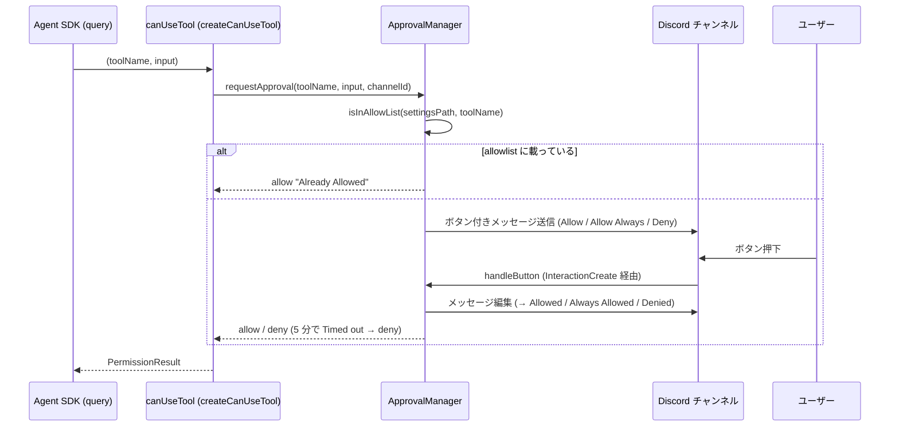

# ツール承認 (canUseTool / AskUserQuestion / allowlist)

Claude Agent SDK がツールを使う前に呼ぶ `canUseTool` コールバックを in-process で実装し、Discord のボタン/select menu/Modal でユーザーの承認・回答を集める仕組み。`client/discord/approval/manager.ts` の `ApprovalManager` と `createCanUseTool()`、`client/discord/approval/question.ts` の `QuestionManager`、`core/approval-settings.ts` の allowlist 読み書きで構成される。承認 UI の送信先チャンネルは呼び出し側 (`client/discord/mod.ts`/`cron/executor.ts`) がターンごとに決める。

関連: [README](README.md)/[message-flow](message-flow.md)/[claude-integration](claude-integration.md)/[cron](cron.md)/[deployment](deployment.md)

## 全体像

許可判定は 2 層ある。

| 層                          | 場所                                                         | 挙動                                                                                                                                                            |
| --------------------------- | ------------------------------------------------------------ | --------------------------------------------------------------------------------------------------------------------------------------------------------------- |
| SDK 側 allowlist            | `.claude/settings.json` の `permissions.allow` (SDK が読む)  | `claude/mod.ts` の `buildQueryOptions()` が `settingSources: ["user", "project"]` を指定するため SDK 自身が読む。載っているツールは `canUseTool` を呼ばずに通す |
| アプリ側 allowlist 事前判定 | `ApprovalManager.requestApproval()` 冒頭の `isInAllowList()` | 同じファイルを読み、載っていれば Discord に聞かず即 allow (`reason: "Already Allowed"`) を返す                                                                  |

どちらも同一ファイルを参照する。`Allow Always` で追記されたツールは、以降の `requestApproval()` がファイルを読み直すためアプリ側の事前判定で即 allow になり、次回の `query()` からは SDK 側で事前許可される (`core/approval-settings.ts` の doc コメント)。

`.claude/settings.json` のパスは `client/discord/mod.ts` の `DiscordBot` コンストラクタで `join(config.claude.cwd, ".claude", "settings.json")` として `ApprovalManager` に渡される。`config.claude.cwd` は `config.ts` の `loadConfig()` が `process.cwd()` を注入する値で、本番 (Docker) ではワークスペースの `/data/workspace` になる (host では `data/workspace/.claude/settings.json`)。中身の allowlist は運用依存のためここでは列挙しない。配置は [deployment](deployment.md) を参照。

Discord のボタン承認が発火するのは、上の表のとおり SDK 上の既定 (allow に無いツール) が呼ばれたときに限る。ワークスペースの `settings.json` の `permissions.allow` では組み込みツール群と一部の MCP ツールを事前許可している。一覧は `data/workspace/.claude/settings.json` を正とする。

旧名 (現行 MCP に存在しない `gcal_*`/`gmail_*` の 4 件) の削除は行ったが、有効な許可範囲は変えていない。allowlist は現状維持 (縮小しない) と 2026-08-23 に判断した (#120)。

## ApprovalManager (`client/discord/approval/manager.ts`)

### 状態

| フィールド        | 型                                     | 用途                                                                                                                                                                                                  |
| ----------------- | -------------------------------------- | ----------------------------------------------------------------------------------------------------------------------------------------------------------------------------------------------------- |
| `pending`         | `Map<requestId, { resolve, timeout }>` | 応答待ちの承認リクエスト。`requestId` は `crypto.randomUUID().slice(0, 8)`                                                                                                                            |
| `questions`       | `QuestionManager`                      | `AskUserQuestion` 用。コンストラクタで同じ `Client` から生成                                                                                                                                          |
| `settingsPath`    | `string`                               | `.claude/settings.json` の絶対パス                                                                                                                                                                    |
| `channelResolver` | `ApprovalChannelResolver`              | `requestApproval()` のチャンネル解決 (`fetchSendable(channelId)`)。コンストラクタの `options.channelResolver` で差し替え可能 (既定は `client` から作った discord.js 実装)。テストで fake に差し替える |
| `timeoutMs`       | `number`                               | 承認待ちのタイムアウト。既定は `INTERACTION_TIMEOUT_MS`。コンストラクタの `options.timeoutMs` でテスト用に短縮可能                                                                                    |

`channelId` を保持する共有の可変状態は無い。送信先チャンネルは呼び出し元がターンごとに `requestApproval()`/`requestAnswers()` の引数として必須で渡す。

### `requestApproval(toolName, toolInput, channelId)`

1. `isInAllowList(settingsPath, toolName)` が true なら即 `{ decision: "allow", reason: "Already Allowed" }`。
2. チャンネル解決: 引数 `channelId` が無ければ `{ decision: "deny", reason: "No approval channel" }`。`channelResolver.fetchSendable(channelId)` が `null` を返す (取得できない、またはテキストチャンネルでない) 場合は `{ decision: "deny", reason: "Channel not found" }`。reject した (REST の失敗等) 場合は、`channelId` 付きの WARN ログを出して `{ decision: "deny", reason: "Failed to resolve channel" }`。
3. 以下を投稿する。
   - ボタン 3 種:
     - `approve:{requestId}` (Allow, Success)
     - `always:{requestId}` (Allow Always, Primary。ツール名は customId に載せず、`pending` が `toolName` として持つ。customId の 100 文字上限と、ツール名中の `:` の影響を受けない)
     - `deny:{requestId}` (Deny, Danger)
   - 本文: 1 行目に `Tool: {toolName}` (太字 + インラインコード)、`toolInput.description` があればその値、続けて `toolInput` の 2 スペース JSON ダンプを json コードフェンスで囲んだもの。`description` は回答の要約と同じ `formatSummaryPart()` (`question.ts`) で整える。改行などの制御文字を空白にして 1 行にし (複数行の説明は 1 行に潰れる)、Markdown の記号をエスケープし、300 文字で切る。その後、`manager.ts` の `escapeLineStart()` が先頭の空白を除き、行頭でだけ効く記号 (`#`・`>`・`-`、番号付きリストの `1.`) をバックスラッシュでエスケープする (`1.` は `.` の前に置いて `1\.` にする。空白だけなら description の行は出さない)。JSON ダンプの連続するバッククォートは (切り詰めより前に)、隣り合う間にゼロ幅スペース (U+200B) を挟んで無害化し、フェンスが早く閉じないようにする。ツール名はヘッダの表示だけ、`replaceControlChars()` (`question.ts`。制御文字 U+0000〜U+001F・U+007F と U+2028・U+2029 を空白にする。CRLF も空白 1 つ) を通し、続けてバッククォートをすべて `'` に置き換えてからインラインコードで囲む (改行・単独のバッククォートでインラインコードが閉じたり行をまたいだりしないようにする。置き換え後は制御文字もバッククォートも残らない)。allowlist に保存するツール名 (`pending.toolName`) と customId は元のまま。ダンプは `truncate()` で 1500 文字 (本文の予算が小さければそれ) に切り詰める。`truncate()` は切れ目が上位サロゲートの直後なら、それを落として末尾に `…` を付けるので、絵文字が壊れた形で残らない (ヘッダと `appendStatus` にも同じく効く)。本文全体は切り詰めず、ヘッダの長さと結果表示の余白 (`STATUS_RESERVE`) を引いたダンプ側の予算で収める。結果表示の文言は `manager.ts` の `STATUS_SUFFIX` に集め、`STATUS_RESERVE` はその最長の長さから導く (数値を手で持たない)。`question.ts` の suffix は `appendStatus` が本文側を切って必ず収めるので、余白は承認メッセージの本文を切らないためのもの。全体は 2000 文字 (`DISCORD_MESSAGE_LIMIT`) に収まる。投稿 (`channel.send`) が失敗したら `pending` を作らず `{ decision: "deny", reason: "Failed to post approval request" }` を返す
4. `pending` に登録し Promise を返す。`handleButton()` が解決するか、`INTERACTION_TIMEOUT_MS` (`client/discord/approval/constants.ts`、5 分) 経過で `{ decision: "deny", reason: "Timed out" }` に解決する。タイムアウト時は投稿メッセージを `\n**→ Timed out**` に編集してボタンを外す (編集失敗は WARN ログ)。`signal` (ターンの中断シグナル) が abort された場合は、送信前なら投稿せず、待機中なら `pending` を消して `\n**→ Aborted**` に編集し、`{ decision: "deny", reason: "Aborted" }` に解決する。abort 後のボタン押下は「期限切れか処理済み」の応答になる。結果の追記は `appendStatus()` が元本文を `2000 - suffix.length` で切ってから suffix を足すので、末尾の `**→ ...**` は切り落とされない。

### `handleButton(interaction)`

`client/discord/interaction.ts` の `dispatchInteraction()` から `interaction.isButton()` のとき呼ばれる。先頭で `isAuthorized()` を通った interaction だけが届く (振り分けは [message-flow](message-flow.md))。

1. まず `QuestionManager.handleButton()` に渡し、質問側の Cancel ボタン (`question-cancel:{requestId}`) なら終了。
2. `customId` を `:` で分割し、`approve`/`always`/`deny` 以外、または `requestId` 欠落なら `false` を返す。
3. `pending` に無い (期限切れ・処理済み) なら ephemeral で「この承認リクエストは期限切れか、既に処理済みです。」と返す。
4. timeout を解除し `pending` から削除する。
5. `always` なら `pending` が持つツール名で `addToSettingsAllowList(settingsPath, toolName)` を呼ぶ。失敗しても WARN ログを出し、承認自体は続行する。ただし結果表示は `Always Allowed` ではなく `Allowed (settings.json への保存に失敗)` にし、`reason` も `Allowed (not persisted)` にする。
6. `approve`/`always` → `decision: "allow"`、`deny` → `decision: "deny"`。`reason` はラベル (`Allowed`/`Always Allowed`/`Denied`。Allow Always の保存失敗時は `Allowed (not persisted)`)。
7. 元メッセージを `interaction.update()` で `\n**→ {ラベル}**` (保存失敗時は上記の文言) を追記しボタンを外す。

### `isInAllowList(settingsPath, toolName)` (`core/approval-settings.ts`)

ファイルを読んで `permissions.allow` 配列に `toolName` が含まれるかを判定する。ファイル不在・JSON 不正は false として扱う。

### `addToSettingsAllowList(settingsPath, toolName)` (`core/approval-settings.ts`)

ファイルが無ければ空オブジェクトから作る (NotFound 以外の読み込みエラーは throw)。JSON 不正なら `settings.json is invalid JSON: {path}` で throw し、ファイルには触れない (呼び出し側の `handleButton` が WARN ログに落とし、今回 1 回の allow は有効なまま)。JSON として有効でも、トップレベルがプレーンなオブジェクト (配列・`null`・プリミティブを除く) でないとき、`permissions` が配列またはプリミティブのとき、`permissions.allow` が配列でない (`null` を除く)、または文字列以外の要素を含むときは、それぞれ `settings.json is not a JSON object: {path}`・`settings.json permissions is not a JSON object: {path}`・`settings.json permissions.allow is not an array: {path}`・`settings.json permissions.allow has a non-string entry: {path}` で throw し、ファイルには触れない (作り直すと元の値を黙って捨てるため)。`permissions`/`permissions.allow` が無い、または明示の `null` のときは、守るべき元の値が無いので作り直す (兄弟キーは保つ)。既存フィールドは保持してマージし、重複なら追加しない。

同一 path への呼び出しはモジュールスコープの Promise チェーンで直列化し、read-modify-write を 1 つずつ実行する (先行が失敗しても後続は走る)。親ディレクトリを `mkdir -p` 相当で作り、同ディレクトリの一時ファイル (`{path}.{pid}.{uuid}.tmp`) に `JSON.stringify(settings, null, 2) + "\n"` を書いて `rename` で置き換える。`settings.json` が symlink なら `realpath` で実体を解決し、実体と同じディレクトリの一時ファイルから実体へ `rename` する (symlink は保たれる)。既存ファイルがあればその mode を一時ファイルへ `chmod` で写す。失敗時は一時ファイルを消して (消せなくても握って) 元のエラーを再 throw する。プロセス間ロックは持たない (単一プロセス前提)。

## QuestionManager (`client/discord/approval/question.ts`)

`AskUserQuestion` は承認ではなく回答収集のツールなので、ボタン承認とは別の UI (string select + Cancel ボタン + Other 用 Modal) を使う。`ApprovalManager.requestAnswers()` は呼び出し元から必須で受け取った `channelId` をそのまま `QuestionManager` に委譲する。

### `parseQuestions(input)`

`canUseTool` が受けた入力から `Question[]` を取り出す純粋関数。次のいずれかで `undefined` (不正) を返す。

- `input.questions` が配列でない
- 質問数が 1 未満または `MAX_QUESTIONS` (4) 超。4 は Discord の action row 上限 5 (select 4 行 + Cancel 1 行) に由来し、SDK スキーマの上限とも一致する
- 各質問の `question`/`header` が string でない、`options` が配列でない、または空
- 選択肢が object でない、`label` が空文字または string でない

選択肢は先頭 `MAX_OPTIONS` (24) 件に切り詰める。`MAX_OPTIONS` は Discord の select 上限 25 から Other 1 件を引いた数である。`description` 欠落は空文字、`multiSelect` 欠落は false。

### `requestAnswers(questions, channelId?)`

1. `channelId` 無し → `{ kind: "denied", reason: "No channel to ask the user" }`。取得不可・非テキスト → `{ kind: "denied", reason: "Channel not found" }`。`channels.fetch` の reject → `{ kind: "denied", reason: "Failed to resolve channel" }` (`channelId` 付きの WARN ログ)。質問メッセージの送信 (`send`) の reject → `{ kind: "denied", reason: "Failed to post questions" }`。
2. 本文 `**Claude からの質問**` + 各質問の `**{n}. {header}** — {question}` (2000 文字で切り詰め) と、質問ごとの string select (`question:{requestId}:{index}`) + 末尾に Cancel ボタン (`question-cancel:{requestId}`) を投稿する。
   - select の選択肢は各 option (value は index 文字列、label/description は 100 文字で切り詰め) に加え、`Other (自由入力)` を自動で末尾に足す。値は `OTHER_VALUE` (`__other__`) とする
   - `multiSelect` の質問は `maxValues = options.length + 1`、それ以外は 1
   - 回答済みの質問の select は disabled にし、placeholder に回答を表示する
3. `INTERACTION_TIMEOUT_MS` (`client/discord/approval/constants.ts`、5 分) でタイムアウト。メッセージを `\n**→ Timed out**` に編集し `{ kind: "denied", reason: "Timed out" }`。`signal` が abort された場合も同様に `\n**→ Aborted**` に編集し `{ kind: "denied", reason: "Aborted" }` (送信前に abort 済みなら投稿しない)。

### インタラクション

| ハンドラ       | customId                             | 挙動                                                                                                                                                                                                              |
| -------------- | ------------------------------------ | ----------------------------------------------------------------------------------------------------------------------------------------------------------------------------------------------------------------- |
| `handleSelect` | `question:{requestId}:{index}`       | `resolveSelectedLabels()` で値をラベルに解決。`OTHER_VALUE` が含まれていれば併選択ラベルを `pendingOther` に退避して Modal を開く。含まれなければ `formatAnswer()` (`", "` 連結) で回答を確定し `applyProgress()` |
| `handleModal`  | `question-other:{requestId}:{index}` | Modal (`TextInputStyle.Paragraph`、必須、最大 1000 文字) の本文を trim し、退避したラベルの後ろに連結して確定。空なら `(no answer)`。`interaction.isFromMessage()` のときのみ `applyProgress()`                   |
| `handleButton` | `question-cancel:{requestId}`        | `{ kind: "denied", reason: "Cancelled by user" }` で解決し、メッセージを `\n**→ Cancelled**` に編集                                                                                                               |

`applyProgress()`: 未回答が残っていればコンポーネントだけ更新する。全問回答済みなら `{ kind: "answered", answers: { [質問文]: 回答文字列 } }` で解決し、メッセージを `\n**→ 回答済み**\n` + `**{header}**: {回答}` の要約を suffix として `appendStatus()` に渡して編集し、コンポーネントを外す。要約には長さの上限が無いので、header と回答それぞれを `formatSummaryPart()` で整える。`replaceControlChars()` で制御文字・U+2028・U+2029 (改行を含む。CRLF は空白 1 つ) を空白に置き換え (行頭でだけ効く `>`・`#`・リストを効かなくし、1 質問 1 行に保つ)、discord.js の `escapeMarkdown()` (既定) で Markdown の記号をエスケープし、header は 80 文字、回答は 200 文字に別々に `truncate()` で切る (header が長くても回答が残る)。`escapeMarkdown()` は 4 連以上のバッククォートに素のバッククォートを残すので、バッククォートの連なりは自前で 1 つずつ `` \` `` にし、それ以外の部分だけ `escapeMarkdown()` に渡す。エスケープ後に切るので、切れ目にエスケープ用のバックスラッシュ (対にならない奇数個) だけが残った場合は落とす。要約全体も 1200 文字に切るが、1 行は最大 80 + 200 + 6 文字なので 4 質問でも収まる。JSON ダンプの `neutralizeBackticks()` はそのまま。本文側が `appendStatus()` で切られ、`→ 回答済み` と要約は必ず 2000 文字 (`DISCORD_MESSAGE_LIMIT`) 以内で残る。期限切れ・処理済みのインタラクションには ephemeral で「この質問は期限切れか、既に処理済みです。」と返す。

## `createCanUseTool(manager, channelId?)`

SDK の `CanUseTool` を返す。`ApprovalResult`/`QuestionResult` を SDK の `PermissionResult` へ変換する表:

| 入力                                                 | 返り値                                                                |
| ---------------------------------------------------- | --------------------------------------------------------------------- |
| `AskUserQuestion`、`parseQuestions()` が `undefined` | `{ behavior: "deny", message: "Malformed AskUserQuestion input" }`    |
| `AskUserQuestion`、`requestAnswers()` が `answered`  | `{ behavior: "allow", updatedInput: { ...input, answers } }`          |
| `AskUserQuestion`、`requestAnswers()` が `denied`    | `{ behavior: "deny", message: "The user did not answer (<reason>)" }` |
| その他、`requestApproval()` が `allow`               | `{ behavior: "allow", updatedInput: input }`                          |
| その他、`requestApproval()` が `deny`                | `{ behavior: "deny", message: result.reason ?? "Denied" }`            |

`AskUserQuestion` の deny はモデルに回答なしで続行させる意味になる。

### `permissions.allow` に `AskUserQuestion` を入れない

`AskUserQuestion` が SDK 側 allowlist に載っていると、SDK が `canUseTool` を呼ばずに素通しするため `QuestionManager` に到達せず、回答が空のまま解決される。このツールは allowlist に入れないこと (`client/discord/approval/manager.ts` の `createCanUseTool` の doc コメントに同じ注意がある)。

## 呼び出し側

| 経路                    | 場所                                                                                                                    | `createCanUseTool()` の `channelId`                                                              |
| ----------------------- | ----------------------------------------------------------------------------------------------------------------------- | ------------------------------------------------------------------------------------------------ |
| チャット                | `core/conversation.ts` `Conversation` (`createCanUseTool(localId)` は `client/discord/mod.ts` の `DiscordBot` が橋渡し) | `localId` (スレッド内ならスレッド ID、そうでなければチャンネル ID)。承認 UI は発話スコープに出る |
| cron                    | `cron/executor.ts` `CronExecutor` (`CronPorts.createCanUseTool()` を `client/discord/cron-target.ts` が実装)            | `job.channelId` (未指定なら `undefined`)                                                         |
| AI to AI 自己メンション | チャットと同じ経路                                                                                                      | 同上。承認 UI は自己起動されたスコープに出る                                                     |
| セッション間の依頼      | チャットと同じ経路 (`submitSessionRequest()` → `Conversation.submit()`)                                                 | 同上。承認 UI は依頼の対象のスコープ (チャンネル / スレッド) に出る                              |

cron で `channelId` 未指定のジョブでは、`createCanUseTool()` に渡る `channelId` が `undefined` になり、`requestApproval()`/`requestAnswers()` はその場で `"No approval channel"`/`"No channel to ask the user"` を返して deny する。ターン間で共有される状態は無いため、他ターンの設定へフォールバックすることもない。

自己メンション・セッション間の依頼で起動したターンでは、承認ボタン・質問は通常どおりそのスコープに投稿される。承認・質問メッセージの本文には意図してユーザーメンションを入れないので本人宛てのピングは無く、本人が見ていなければ 5 分の timeout で deny になり、依頼元には通知されない。`description` や回答の要約にメンションが紛れても、`client/discord/mod.ts` が Client の既定に設定した `allowedMentions` (`parse: []`、`users` は認可ユーザーのみ) が、承認・質問メッセージの送信と編集、インタラクションの応答に付く。そのため認可ユーザー宛て以外 (`@everyone`・role・他ユーザー・bot) は解決されない。

`InteractionCreate` からの振り分け (`isButton()` → `handleButton`、`isStringSelectMenu()` → `handleSelect`、`isModalSubmit()` → `handleModal`、それ以外はスラッシュコマンド) と各ハンドラのエラー時の ephemeral 応答 (`runInteraction()`。未応答なら `reply()`、返信済み・defer 済みなら `followUp()`) は `client/discord/interaction.ts` の `dispatchInteraction()` にある。承認ボタン・select・modal も含む全種別が、振り分けの前に `isAuthorized()` を通り、認可されない操作は pending に触れず ephemeral で拒否される。詳細は [message-flow](message-flow.md) で扱う。`canUseTool` を `query()` の options に載せる箇所は [claude-integration](claude-integration.md) を参照。

## テスト

| ファイル                                   | 対象                                                                                                                                                                                                                                                                                                                                                                                                                                                                                                                                    |
| ------------------------------------------ | --------------------------------------------------------------------------------------------------------------------------------------------------------------------------------------------------------------------------------------------------------------------------------------------------------------------------------------------------------------------------------------------------------------------------------------------------------------------------------------------------------------------------------------- |
| `client/discord/approval/manager.test.ts`  | `createCanUseTool()` の変換表 (fake `ApprovalManager` で allow / deny / AskUserQuestion の各分岐を検証)。加えて `ApprovalManager` 本体の `requestApproval()` → `handleButton()` (承認 / 拒否 / タイムアウト / channelId 未指定 / チャンネル解決の reject / 長いツール名・`:` 入りツール名の Allow Always / 絵文字とバッククォートでの本文の健全性 (単独のバッククォート・改行や制御文字を含むツール名のヘッダと、保存されるツール名が元のままであること) / 保存失敗時の結果表示) を、`ApprovalChannelResolver` を fake に差し替えて検証 |
| `client/discord/approval/question.test.ts` | 純粋関数 `parseQuestions` / `resolveSelectedLabels` / `formatAnswer` / `truncate` (サロゲート) / `formatSummaryPart` (エスケープ・改行・末尾のバックスラッシュ)、回答済みの要約 (エスケープ・1 質問 1 行・2000 文字以内)、`QuestionManager.requestAnswers` の送信前後の失敗と abort                                                                                                                                                                                                                                                     |
| `core/approval-settings.test.ts`           | `addToSettingsAllowList` (新規作成・マージ・重複排除・形の検査 (非オブジェクト・非配列・非文字列要素は throw、null は作り直し)) と `isInAllowList` (存在・不在・JSON 不正)                                                                                                                                                                                                                                                                                                                                                              |

`ApprovalManager` はチャンネル解決 (`client.channels.fetch()` → 送信) を `ApprovalChannelResolver` (`fetchSendable()`) に切り出してあり、コンストラクタの `options.channelResolver` で差し替えられる (既定は `client` から作った discord.js 実装)。`options.timeoutMs` で `INTERACTION_TIMEOUT_MS` (既定値は変えない) をテスト用に短縮できる。一方 `handleButton()` の引数型は discord.js の `ButtonInteraction` のまま (`QuestionManager.handleButton()` への委譲が同じ型を要求するため、`ApprovalManager` 側だけを緩めると型が合わない)。テストでは `handleButton` が実際に触るプロパティ (`customId`/`message.content`/`update`/`reply`) だけを持つ fake オブジェクトを `as unknown as ButtonInteraction` でキャストして渡す (`client/discord/message.test.ts` の fake チャンネルと同じ手法)。`QuestionManager` のインタラクション処理自体は引き続き単体テストの対象外。

## ターンの中断と承認待ち

承認・質問の待ちは `claude.timeout` (ターン全体のタイムアウト) に含まれる。`core/conversation.ts` と `cron/executor.ts` はターンの `AbortSignal.timeout(timeout)` を `askClaude` と `createCanUseTool(…, signal)` の両方へ渡す。`createCanUseTool()` は SDK が `canUseTool` の第 3 引数で渡す `options.signal` とターンの signal を `AbortSignal.any` で合成し、`requestApproval()`/`requestAnswers()` に渡す。どちらかが abort されると承認・質問は打ち切られ、メッセージは `Aborted` に編集される。

進捗メッセージ (`createProgressReporter`) の初回送信が失敗しても `report()` は reject せず、間引き (3 秒) は保ったまま、次の間引き間隔を過ぎた report で再送する。`cleanup()` は `cleaned` フラグを立てる。初回 `send` の待機中 (`sending`) は、間引きを超えた次の `report()` でも二重に送らない。待機中に捨てた `report()` は間引きの時刻を進めない。待機中に `cleanup()` が走った場合、後から届いたメッセージは保持せずその場で削除する。`cleanup()` 後の `report()` は何もしない。ターン終了時の後始末は `runTurnCleanup()` が typing の停止を最初に行い、各 step の失敗を WARN ログにして残りを続行する。
