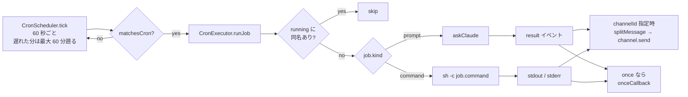

# 定期実行 (cron)

ワークスペース直下の `cron/*.md` (prompt ジョブ、YAML フロントマター + 本文プロンプト) と `cron/*.yaml` (command ジョブ、`sh -c` で実行するコマンド) で定義したジョブを、bot プロセス内のスケジューラが分単位で評価し、マッチしたら prompt ジョブは中核の `runOneShot()` (`core/conversation.ts`、内部で `askClaude()` を呼ぶ) を、command ジョブはコマンドを実行して結果を client (Discord) へ投稿する仕組み。実行器 (`cron/executor.ts`) は discord.js に依存せず、Discord との接点は `CronPorts` に切り出してある。`cron/` ディレクトリが存在しなければ cron 機能は無効になる (ジョブ 0 件でスケジューラだけが動く)。Claude Code 組み込みの `CronCreate`/`CronDelete`/`CronList`/`RemoteTrigger` とは無関係で、ジョブの管理はファイル操作と内部 HTTP API で行う。

関連: [README](README.md)/[lifecycle](lifecycle.md)/[claude-integration](claude-integration.md)/[store-and-settings](store-and-settings.md)/[approval](approval.md)/[internal-api](internal-api.md)/[deployment](deployment.md)

エージェント向けの書き方・運用手順 (reload の検証手順、`once` の注意、cron 式の例等) は `data/workspace/.claude/skills/cron/SKILL.md` に集約されている。本書は実装の構造と事実のみを扱い、手順は重複させない。

## 構成要素

| ファイル                        | シンボル                                      | 役割                                                                                                                              |
| ------------------------------- | --------------------------------------------- | --------------------------------------------------------------------------------------------------------------------------------- |
| `cron/types.ts`                 | `CronJobDef`                                  | ジョブ定義の型 (`kind` で判別する `CronPromptJob` / `CronCommandJob` の union)。loader の出力、scheduler / executor の入力        |
| `cron/match.ts`                 | `parseCronExpression()` / `matchesCron()`     | 5 フィールド cron 式の検証 (`parseCronExpression()`) とタイムゾーン指定でのマッチ判定 (`matchesCron()`)。実体は croner            |
| `cron/loader.ts`                | `loadCronJobsFromDir()` / `validateCronJob()` | `cron/` 走査、フロントマター抽出、JSON Schema 検証                                                                                |
| `cron/scheduler.ts`             | `CronScheduler`                               | 60 秒 tick で全ジョブを評価し (遅れた tick は直近 60 分まで遡って評価)、マッチしたジョブのコールバックを呼ぶ                      |
| `cron/executor.ts`              | `CronExecutor`                                | scheduler を保持し、ジョブ 1 件の実行 (`runOneShot()` → `CronPorts` 経由の送信) を担う。`CronPorts` / `CronTarget` の型定義もここ |
| `client/discord/cron-target.ts` | `createDiscordCronPorts()`                    | `CronPorts` の Discord 実装 (チャンネル解決 + 分割送信、ギルド変数、承認コールバック)                                             |
| `client/discord/mod.ts`         | `DiscordBot.start()`                          | `ClientReady` で executor を生成・起動し、reload / run / list を API へ配線する                                                   |
| `api/routes/cron.ts`            | `createCronRoutes()` / `CronRouteContext`     | `GET /cron` / `POST /cron/run` / `POST /cron/reload`                                                                              |

## 全体の流れ



## ジョブファイル

`cron/{name}.md` (prompt ジョブ) または `cron/{name}.yaml` (command ジョブ)。ジョブ名はファイル名そのもの (拡張子込み、`validateCronJob()`/`validateCommandJob()`)。`.yml` は対象外。

### prompt ジョブ (`.md`)

フロントマターが `CronPromptJob` のメタデータ、本文 (trim 後) がプロンプトになる。

最小例:

```markdown
---
schedule: "0 9 * * *"
channelId: "{channelId}"
---

今日の予定を要約して。
```

#### フロントマターのフィールド

`cron/loader.ts` の `frontMatterSchema` (JSON Schema、`@cfworker/json-schema` で検証) が受け付けるキーは次のとおり。

| フィールド      | 必須 | 型                          | 既定                     | 説明                                                                                                                             |
| --------------- | ---- | --------------------------- | ------------------------ | -------------------------------------------------------------------------------------------------------------------------------- |
| `schedule`      | yes  | string (1 文字以上)         | —                        | 5 フィールド cron 式 (croner の構文、後述)。構造検証通過後に `parseCronExpression()` で構文を別途検証する。評価は TZ 依存 (後述) |
| `channelId`     | no   | string \| number            | —                        | 結果の投稿先、かつ承認ボタン / `AskUserQuestion` の送信先。`String()` で文字列化して保持。省略時は結果を投稿しない               |
| `resumeSession` | no   | boolean                     | `false`                  | `true` のときだけ前回セッションを resume する                                                                                    |
| `maxTurns`      | no   | integer (1 以上)            | `config.claude.maxTurns` | `ClaudeConfig.maxTurns` のオーバーライド                                                                                         |
| `timeout`       | no   | integer (ms, 1..2147483647) | `config.claude.timeout`  | `askClaude()` に渡す `AbortSignal.timeout()` のミリ秒                                                                            |
| `once`          | no   | boolean                     | `false`                  | `true` なら 1 回実行後 (成否を問わず) にジョブファイルを削除して reload する                                                     |
| `model`         | no   | string                      | —                        | モデル alias / full name のオーバーライド                                                                                        |
| `effort`        | no   | string (enum)               | —                        | `claude/mod.ts` の `EFFORT_LEVELS` (`low` / `medium` / `high` / `xhigh` / `max`) のいずれか                                      |

- `additionalProperties: false` のため、上記以外のキー (typo 等) は検証エラーになる。ファイル単位の失敗として扱われるため、当該ジョブだけが loader (下記) でスキップされ、他のジョブの読み込みは続く。
- 本文が空 (trim 後に空文字) のファイルは検証エラーになる。エラーメッセージは `prompt body is empty` である。
- `channelId` は YAML で引用符なしに書くと数値として読まれるため、型は `string | number` の `oneOf` で受け、`CronJobDef.channelId` へは文字列として格納する。

### command ジョブ (`.yaml`)

ファイル全体が `CronCommandJob` のメタデータになる (フロントマター / 本文の区別は無い)。`command` を `sh -c` で実行し、標準出力を結果として扱う。

最小例:

```yaml
schedule: "0 9 * * *"
command: "cron/scripts/check.sh"
```

#### フィールド

`cron/loader.ts` の `commandSchema` (JSON Schema、`@cfworker/json-schema` で検証) が受け付けるキーは次のとおり。

| フィールド  | 必須 | 型                          | 既定                    | 説明                                            |
| ----------- | ---- | --------------------------- | ----------------------- | ----------------------------------------------- |
| `schedule`  | yes  | string (1 文字以上)         | —                       | prompt ジョブと同じ                             |
| `command`   | yes  | string (1 文字以上)         | —                       | `sh -c` に渡すコマンド文字列                    |
| `channelId` | no   | string \| number            | —                       | prompt ジョブと同じ (結果の投稿先)              |
| `timeout`   | no   | integer (ms, 1..2147483647) | `config.claude.timeout` | コマンド実行の `AbortSignal.timeout()` のミリ秒 |
| `once`      | no   | boolean                     | `false`                 | prompt ジョブと同じ                             |

- `additionalProperties: false` のため、`maxTurns`/`model`/`effort` 等 prompt ジョブ専用のキーを書くと検証エラーになる。
- 判断が必要な処理は prompt ジョブ (Claude) に任せ、command ジョブは定型処理 (固定のチェック・通知等) に使う想定。
- 複雑なロジックは `cron/scripts/{name}.sh` に外出しし、`command` からはそれを呼ぶだけにする運用を推奨する (`command: "cron/scripts/check.sh"`)。

## loader (`cron/loader.ts`)

`loadCronJobsFromDir(workspaceDir)` は `join(workspaceDir, "cron")` を `readdir()` で走査し、`.md` と `.yaml` のファイルを対象にする (`.yml` は対象外)。

- `.md`: `@std/front-matter/yaml` の `extract()` で `attrs`/`body` に分け、`validateCronJob(attrs, body.trim(), filename)` で `CronPromptJob` に変換する。
- `.yaml`: `@std/yaml` の `parse()` でファイル全体をパースし、`validateCommandJob(parsed, filename)` で `CronCommandJob` に変換する。`parse()` の戻り値がオブジェクトでない (配列・スカラー等) 場合は `validateCommandJob()` が `"yaml must be an object"` を throw する。

`validateCronJob()`/`validateCommandJob()` はどちらもスキーマ不適合時に `@cfworker` のエラーを共通のヘルパー `formatSchemaErrors()` で人間向けメッセージ (`"schedule" is required and must be a non-empty string` 等) に変換し、複数のエラーを `"; "` で連結して 1 つの `Error` として throw する。`shortCircuit: false` で全エラーを収集している。

- ディレクトリが無い (`ENOENT`。`isNotFoundError()` で判定) 場合は INFO ログを出して空配列を返す。それ以外の読み取りエラーは throw する。
- ファイル単位の失敗 (YAML 構文エラー、スキーマ不適合、cron 式の構文エラー、prompt ジョブの本文空、command ジョブの yaml がオブジェクトでない) は `cron-loader` 名前空間に ERROR ログを出してそのファイルを skip し、残りのファイルの読み込みを続ける。このため `POST /cron/reload` はファイルの失敗があっても `{ "ok": true }` を返す (reload の戻りは登録の成否を表さない)。登録結果の確認手順は cron skill と [internal-api](internal-api.md) を参照。

## match (`cron/match.ts`)

パースと一致判定は [croner](https://github.com/Hexagon/croner) に委ねる。5 フィールド (分 時 日 月 曜日) の cron 式を扱う。

- `new Cron(expression, { mode: "5-part", domAndDow: true, timezone })` を使う。`mode: "5-part"` で 5 フィールド以外 (秒・年を足した 6・7 フィールド) は構文エラーになる。`domAndDow: true` で日と曜日を両方指定した場合は AND で評価する (croner の既定は OR)。
- 構文は croner のもの。`*`、`N`、`N-M`、`*/step`、`N-M/step`、カンマ区切りのリストに加え、月名・曜日名 (`JAN`、`MON`)、`L`/`W`/`#`/`?`、ニックネーム (`@daily`、`@hourly` 等) も通る。曜日は 0 も 7 も日曜。`N/step` (数値始まりのステップ) と、フィールドの最大値を超えるステップ (分の `*/90` 等) は構文エラーになる。
- `parseCronExpression(expression)` は構文検証だけを行い、戻り値は無い (`void`)。不正なら throw する。croner は `:` を含む文字列を ISO 日時の 1 回きりの予定として受理し `mode` を素通りするため、croner に渡す前に空白区切り 5 フィールドであること (ニックネームを除く) を確かめる。また `nextRun()` が `null` の式 (`0 9 31 2 *` 等、永遠に来ない式) も throw する。loader がジョブ読み込み時に呼ぶ。
- `matchesCron(expression, now?)` は `now` 省略時に `Temporal.Now.zonedDateTimeISO()` を使い、`now.timeZoneId` (システムのタイムゾーン。コンテナでは compose が渡す `TZ`) で評価する。`now` は分の先頭に切り捨ててから croner の `match()` に渡す。croner の 5-part は秒を 0 に固定するため、秒が 0 でない時刻で不一致になるのを避ける。
- `Cron` インスタンスは式とタイムゾーンの組でモジュールレベルの `Map` にキャッシュする。理由: 同じ式を毎分評価するため。callback なしで生成するのでタイマーは張られない。

## scheduler (`cron/scheduler.ts`)

`CronScheduler` はコンストラクタでコールバック `(job: CronJobDef) => void` を受け取り、`setInterval` ベースで動く。

- `TICK_INTERVAL_MS = 60_000`。`start()` は現在時刻から次の分境界までの残り ms を `setTimeout` で待ってから最初の `tick()` を実行し、その後 `setInterval` で 60 秒ごとに `tick()` を回す。既に開始済みなら何もしない。
- `tick(now?)` は `epochMilliseconds / TICK_INTERVAL_MS` の floor を分キーとして `lastTickMinute` と比較し、同一分なら何もしない (二重発火ガード)。その後、登録済みの全ジョブについて `matchesCron(job.schedule, ...)` を評価し、マッチしたジョブごとにコールバックを呼ぶ。
- 追いつき走査: `lastTickMinute` がある場合は、その次の分から現在の分まで (`MAX_CATCH_UP_MINUTES = 60` が上限) を走査し、いずれかの分に一致したジョブを 1 tick につき 1 回だけ起動する。初回の tick (`lastTickMinute` 無し。`stop()` でも戻る) は現在の分だけを見る。上限を超えた遅延 (長時間のスリープ等) では直近 60 分だけを遡り、それより前の分は起動しない。
- ジョブ 1 件の評価で例外が出ても `try / catch` で ERROR ログに落とし、他のジョブの評価を続ける (ジョブ単位のエラー隔離)。コールバックは戻り値を待たずに呼ぶため、executor の非同期処理は tick をブロックしない。
- `replaceAll(jobs)` は内部の `Map<name, CronJobDef>` を丸ごと差し替える。タイマーは維持されるため、実行中のスケジューラに対するホットスワップになる。`stop()` はアライン用 `setTimeout` と `setInterval` を両方止め、`lastTickMinute` をリセットする。
- `getJob(name)`/`getAllJobs()`/`size` を公開し、executor の `findJob()`/`listJobs()` がこれを使う。

## executor (`cron/executor.ts`)

`CronExecutor` は `CronScheduler` を内部に持ち、コンストラクタで options object (`CronExecutorOptions`) として `ports` (`CronPorts`)、`config` (`ClaudeConfig`)、`env` (`query()` の env へ追加で注入する環境変数)、`store`、`defaults` (`ClaudeDefaults`)、`systemPrompts`、任意の `queryFn` (テスト用 DI)、`runCommandFn` (`RunCommandFn`、既定は `runShellCommand`。テスト用 DI) を受け取る。

`CronPorts` は実行器が client に求める操作を定義した IF で、実行器側が定義し client が実装する (依存は client → cron の一方向)。

```ts
interface CronTarget {
  send(text: string): Promise<void>; // メッセージ長に合わせた分割は実装側
}

interface CronPorts {
  resolveTarget(channelId: string): Promise<CronTarget>; // 見つからない・送信不可なら throw
  guildTemplateVars(): Record<string, string>; // discord.guild.id / discord.guild.name
  createCanUseTool(channelId: string | undefined): CanUseTool;
}
```

Discord 実装 (`client/discord/cron-target.ts` の `createDiscordCronPorts({ client, guildId, approvalManager })`) は、`resolveTarget()` で `client.channels.fetch()` し、`send` を持たなければ `channel {id} not found or not a text channel` を throw する。`CronTarget.send()` は `splitMessage()` で 2000 文字に分割して `channel.send()` する。`start(jobs)` は `replaceAll` → `scheduler.start()`、`reload(jobs)` は `replaceAll` のみ (実行中のジョブはそのまま完了し、次の tick から新定義が効く)、`stop()` は `scheduler.stop()`。`isRunning(name)` は並行実行ガード (`running: Set<string>`) の状態を読む公開メソッドで、テストから使う。

`runJob(job)` が 1 件の実行本体で、スケジューラのコールバックと `POST /cron/run` の両方から呼ばれる。共通処理の後、`job.kind` で `runPromptJob()`/`runCommandJob()` (どちらも private) に分岐する。

1. 並行実行ガード: `running: Set<string>` に同名ジョブがあれば WARN ログを出して return する。無ければ追加する。このガードはジョブ名単位であり、別名ジョブは同一 tick で同時に起動する。
   - news-* 6 本は 8:00 に揃えて同時起動させている。2026-08-23 に 10 分刻みへ分散したが、分散前 (2026-08-23 以前) の同時起動でも負荷集中は見られなかったため、2026-08-29 に 8:00 へ戻した。
   - 負荷集中が問題になる場合はジョブ定義側で `schedule` をずらす。
2. 送信先の事前取得: `job.channelId` があれば `ports.resolveTarget(job.channelId)` を await する (解決できなければ throw)。理由: 後段の catch でエラー通知先として使う。prompt / command 両方で共通。
3. `job.kind === "command"` なら `runCommandJob(job, target)`、それ以外 (`"prompt"`) なら `runPromptJob(job, target)` を await する。
4. catch: ERROR ログ (`cron job "{name}" failed:`、全文) を出す。`target` が取得済みなら `target.send()` で `[cron: {name}]` + `summarizeError(error)` (`errors.ts`、定型文 + エラーメッセージの先頭 1 行を要約したもの) を送る。通知自体の失敗は握りつぶす。
5. finally: `job.once` かつ `onceCallback` が設定されていれば `onceCallback(job.name)` を await する (失敗はログのみ)。最後に `running` から削除する。

### `runPromptJob()`

1. ストアの読み取り (3 つを `Promise.all` で並列):
   - session: `resumeSession` が true のときだけ `store.getSession({ channelId: "cron:{name}" })`。false なら `undefined` (毎回新規セッション)。
   - model/effort: `job.channelId` があるときだけ `store.getModel({ channelId: job.channelId })`/`store.getEffort({ channelId: job.channelId })`。つまり **投稿先チャンネルのスコープ設定** を読む (`cron:{name}` スコープではない)。`channelId` 省略時はどちらも `undefined`。
   - 解決順は `job.model ?? channelModel ?? defaults.model`、effort も同様 (frontmatter → チャンネル設定 → `config.claude.defaults`)。いずれも無ければ `askClaude()` に渡さず、SDK 既定に任せる。スコープ解決の一般論は [store-and-settings](store-and-settings.md)。
2. システムプロンプト: `systemPrompts.resolve("cron", { channelId: job.channelId ?? "" }, templateVars)`。context が `"cron"` なので `DEFAULT.md` + `CRON.md` に加え、`job.channelId` と同名の `{channelId}.md` があればそれも結合される (スレッドは無いので thread フォールバックは起きない)。
   - `templateVars` は `ports.guildTemplateVars()` で、ギルドレベルのみ (`discord.guild.id`/`discord.guild.name`)。チャンネル/ユーザー変数は展開されずプレースホルダのまま残る。
   - 詳細は [claude-integration](claude-integration.md)。
3. 設定の組み立て: `jobConfig` は `ClaudeConfig` を spread でコピーし、`job.maxTurns` が指定されていれば `maxTurns` だけ上書きする。`timeout = job.timeout ?? config.timeout`。
4. `runOneShot({ prompt: job.prompt, config: jobConfig, env, sessionId, setSession, signal: AbortSignal.timeout(timeout), appendSystemPrompt, model, effort, canUseTool: ports.createCanUseTool(job.channelId), onNonSuccess, queryFn })` (`core/conversation.ts`) を呼ぶ。`ScopeQueue` は通さない (cron ジョブは scope 単位の直列化の対象外。挙動は従来どおり)。`canUseTool` に渡す `channelId` は `job.channelId` で、省略時は `undefined` となり `ApprovalManager` は自動 deny する (共有状態へのフォールバックは無い)。承認フローは [approval](approval.md)。
5. ストリーム消費: `runOneShot()` が内部で `askClaude()` を呼び、`drainResultEvent(stream, { onNonSuccess, setSession })` (`claude/mod.ts`) で `for await` を回し、`event.type === "result"` イベントごとに `handleResultEvent()` (非 success なら `onNonSuccess` で WARN ログ、`setSession` があれば `event.session_id` で呼ぶ) を呼び、最後の `result` イベントを返す。`text_delta`/`thinking_delta`/`tool_progress` は読まない (ストリーミング投稿・進捗表示・thinking 表示は無い)。`resumeSession` が true なら `setSession` (実行器が渡す) から `store.setSession({ channelId: "cron:{name}" }, newSessionId)` で保存する。`onNonSuccess` の WARN ログ文言 (`cron job "{name}" non-success subtype ...`) は実行器が組み立てて渡す。
6. `runOneShot()` は最後に `requireResultText(resultEvent)` (`claude/mod.ts`) で本文を取り出して返す。`result` 無しで終わっていたら `claude stream ended without result event` を throw する (`target` の有無に関わらず、`runOneShot()` が常に評価するため必ず throw される)。取り出せたら `target` があるときだけ `target.send(text)` する (分割は `CronPorts` 実装側。`channelId` 省略時は投稿しない。プロンプト側で Discord REST API を叩く設計にする)。

`askClaude()`/`drainResultEvent()`/`requireResultText()` は chat と共通の部品で、`runOneShot()` はそれらを束ねただけで cron 固有の分岐は持たない ([claude-integration](claude-integration.md))。

### `runCommandJob()`

ストア (session / model / effort)・システムプロンプト・承認には触れない。

1. `timeout = job.timeout ?? config.timeout`、`signal = AbortSignal.timeout(timeout)`。
2. `runCommandFn(job.command, { cwd: config.cwd, signal })` を try/catch で囲んで await する。既定実装 `runShellCommand` は `node:child_process` の `spawn("sh", ["-c", command], { cwd, stdio: ["inherit", "pipe", "pipe"] })` で起動し、stdout / stderr の `data` を集めて `close` イベントで解決する Promise と「`signal` の abort で reject する Promise」を `Promise.race` する。`close` の終了コードが `null` (シグナル終了) のときは `-1` を返す。`signal` の abort は `sh` に SIGTERM を送るだけで、`sh` が起動した子プロセスは残りうる (孫プロセスが stdout/stderr の pipe を握ったままだと出力の読み取りが返らない)。長時間動く子プロセスを起動するスクリプトは、自前で `trap` 等の後始末をすること。abort 時は `child.kill("SIGTERM")` を呼んで素の `Error("command timed out")` で reject する。`signal` は `spawn` には渡さず、自前の abort ハンドラで扱う。`stdout`/`stderr` は集めたバッファを文字列化して返す。
3. `runCommandFn` が reject した場合、`signal.aborted` なら (`runShellCommand` の素のメッセージを) `command timed out after {timeout}ms` で throw し直す。`signal.aborted` でなければ元のエラーをそのまま throw する。resolve した場合も `signal.aborted` なら (モックが resolve で abort を模す経路向けに) 同じく `command timed out after {timeout}ms` を throw する。reject / resolve のどちらの経路でも、abort 時は文書化された `command timed out after {timeout}ms` が client (Discord) とログに出る。
4. `result.code !== 0` なら、`result.stdout` が空でなければ ERROR ログ (`cron job "{name}" stdout:` + 全文) を出したうえで、`command exited with code {code}: {stderr の先頭行}\n{stderr 全文}` を throw する (先頭行が `summarizeError()` 経由で Discord の要約に、全文が ERROR ログに載る)。
5. `result.stderr` が空でなければ (成功時でも) WARN ログに出す。
6. `result.stdout.trim()` (以下 `output`) が `MAX_COMMAND_OUTPUT_CHARS` (`4000`) を超える場合、先頭 4000 文字に切り詰めて末尾に `\n... (truncated, {元の文字数} chars)` を付ける (ログには全量を出すが、client へは切り詰め後を投稿する)。`output` が空でなく `target` があれば `target.send(output)` する (分割は `CronPorts` 実装側)。空、または `target` が無ければ投稿しない。

### セッションとスコープ

| 項目                   | スコープ                                              | 備考                                                                                  |
| ---------------------- | ----------------------------------------------------- | ------------------------------------------------------------------------------------- |
| session                | `{ channelId: "cron:{name}" }`                        | `resumeSession: true` のときのみ get / set。既定 (`false`) ではストアを読み書きしない |
| model / effort         | `{ channelId: job.channelId }`                        | `channelId` 省略時は読まず `defaults` へ                                              |
| システムプロンプト     | `{ channelId: job.channelId ?? "" }` (context `cron`) | `{channelId}.md` が cron 実行にも適用される                                           |
| 承認 / AskUserQuestion | `job.channelId`                                       | 省略時は `undefined` となり自動 deny (共有状態へのフォールバックは無い)               |

cron のセッション (`cron:{name}`) は投稿先のチャンネル / スレッドの会話とは別の文脈である。投稿先のスコープのセッションへ依頼を渡したいときは、cron のターンから内部 API の `POST /sessions/{channelId}[/{threadId}]/messages` を呼ぶ ([internal-api](internal-api.md)、[message-flow](message-flow.md) の「セッション間の依頼」)。依頼は対象スコープのキューに積まれ、そのスコープの session・model・effort・システムプロンプト・承認で処理される (cron ジョブ自身の `channelId` や設定は使わない)。cron ジョブの frontmatter に `threadId` は無く、依頼先はターン内で API の引数として指定する。

command ジョブ (`runCommandJob()`) はこの表のいずれにも触れない。session / model / effort のストアも、システムプロンプトも、承認 (`ApprovalManager`) も参照・更新しない。

## 起動と API の配線 (`client/discord/mod.ts`)

`DiscordBot.start()` の `ClientReady` ハンドラ内で、スラッシュコマンド登録の後に次を行う。起動順全体は [lifecycle](lifecycle.md)。

1. `new CronExecutor({ ports: createDiscordCronPorts({ client, guildId, approvalManager }), config: config.claude, env: { DISCORD_BOT_TOKEN }, store, defaults: config.claude.defaults, systemPrompts })`。
2. `loadCronJobsFromDir(config.claude.cwd)` でジョブを読み、`cronExecutor.reload(jobs)` で登録だけ行う (タイマーは始めない。スケジューラの開始は手順 7)。`config.claude.cwd` はワークスペースルート (本番は `/data/workspace`、devcontainer では `/app`。[deployment](deployment.md))。
3. `reloadJobs = () => loadCronJobsFromDir(cwd) → cronExecutor.reload(jobs)` を定義する。
4. `cronExecutor.setOnceCallback()` で once 後処理を登録する: `join(cwd, "cron", name)` (`name` は拡張子込みのファイル名) を `rm()` し (失敗は ERROR ログ)、続けて `reloadJobs()` を呼ぶ。エージェント側の手動 reload は不要。
5. `runJobByName(name)`: `cronExecutor.findJob(name)` が無ければ `job not found: {name}` を throw、あれば `runJob(job)` を await してその結果を返す。
6. `CronRouteContext { reloadCronJobs: reloadJobs, runJob: runJobByName, listJobs: () => cronExecutor.listJobs() }` を `startApiServer(config.claude.apiPort, settingsCtx, healthCtx, cronCtx)` に渡す。
7. API サーバーの起動に成功したら `cronExecutor.start(cronExecutor.listJobs())` (起動待ちの間の reload を上書きしないよう、実行器に登録済みのジョブを渡す) でスケジューラを開始する。API サーバーの起動に失敗した時点ではスケジューラは始まっていない。起動待ちの間に `shutdown()` が走った場合は、起動したサーバーをタイムアウト付きで閉じてスケジューラを始めずに終える (それ以前の待機の後でも、実行器を作らず・ポートを開かずに終える)。

`shutdown()` では最初に終了フラグを立てて自分が登録した `MessageCreate` / `InteractionCreate` のリスナを外し、続けて `cronExecutor.stop()` を呼ぶ (実行中のジョブの完了は待たない)。

`/claw settings show` (`client/discord/commands.ts` の `handleSettingsShow()`) は `cronExecutor.listJobs()` を使って登録済みジョブ名とスケジュールを一覧表示する。

### HTTP エンドポイント (`api/routes/cron.ts`)

`createCronRoutes(ctx)` が Hono サブアプリを返し、`api/server.ts` が `/cron` にマウントする。`ctx` の各関数が未注入なら 503 (`cron not available`/`cron reload not available`) を返す。リクエスト/レスポンスの正は `docs/api/paths/cron*.yaml` と、そこから生成した `api/internal-schemas.ts`。詳細は [internal-api](internal-api.md)。

| エンドポイント      | 入力               | 出力                                                                                    |
| ------------------- | ------------------ | --------------------------------------------------------------------------------------- |
| `GET /cron`         | —                  | `{ jobs: [{ name, kind, schedule, channelId?, once }] }` (`channelId` は未指定なら省略) |
| `POST /cron/run`    | `{ name: string }` | `{ ok: true, name, result }`。`name` 不正は 400、未登録は 404 (`job not found: ...`)    |
| `POST /cron/reload` | —                  | `{ ok: true }` (ファイル単位の読み込み失敗があっても 200)                               |

`POST /cron/run` は `runJob()` の完了まで await するため、レスポンスはジョブの実行が終わってから返る。`runJob()` は結果を `CronRunResult` (`succeeded`/`failed`/`skipped`) で返し、レスポンスの `result` に載る。実行中の同名ジョブがあればガードにより skip され (`skipped`)、ジョブ内で例外が起きれば `failed` になるが、どちらも HTTP は 200 のままで 500 にはならない (500 はルート内の想定外の例外のみ)。

## 利用規約との関係

`docs/terms-of-service.md` にあるとおり、サブスクリプションの使用量上限は「個人の通常利用 (ordinary, individual usage)」を前提にしている。cron はこの前提の中で最も機械的にトークンを消費する経路なので、ジョブの本数・スケジュールの頻度・`maxTurns` をその範囲に保つことがこのモジュールの不変条件になる。詳細は [docs/terms-of-service.md](../terms-of-service.md) の「サブスクリプションプランでの Agent SDK 利用」節を参照。
