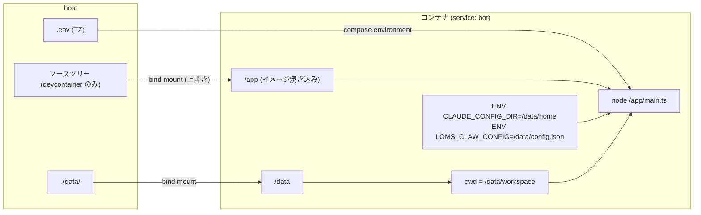

# デプロイと workspace

loms-claw を Docker コンテナとして動かすための構成 (Dockerfile/compose.yaml/devcontainer) と、コンテナに bind mount する実行時データ `data/` のレイアウト、その中のエージェントワークスペース `data/workspace/` の構成をまとめる。正はリポジトリの実ファイルであり、本文で挙げる事実はそれぞれのファイルで確認できる範囲に限る。

関連: [README.md](README.md)/[lifecycle.md](lifecycle.md)/[claude-integration.md](claude-integration.md)/[store-and-settings.md](store-and-settings.md)/[approval.md](approval.md)/[cron.md](cron.md)/[internal-api.md](internal-api.md)

## 全体像



## Dockerfile

`Dockerfile` はリポジトリルートに置く。

- ベースイメージは `docker.io/node:26-bookworm-slim` (Debian ベースの glibc イメージ。既定ユーザは root)。
- `ENV CLAUDE_CONFIG_DIR=/data/home`: Claude Code の設定・認証情報の置き場所を既定の `~/.claude` から bind mount 先へ置き換える。
- `ENV LOMS_CLAW_CONFIG=/data/config.json`: `config.ts` の `loadConfig()` が読む設定ファイルのパス。未設定時の既定は `./data/config.json`。
- apt で `ca-certificates curl git jq bubblewrap socat ffmpeg tzdata` を入れる。Dockerfile のコメントに用途を 1 行ずつ記載している。
  - `ca-certificates`: `curl`/Agent SDK 同梱バイナリの TLS 検証。
  - `curl`/`jq`: workspace の skill (`discord` 等) が REST API を叩く手段。`compose.yaml` の healthcheck でも使う。
  - `git`: Claude Code (同梱バイナリ) がリポジトリ操作・文脈取得に使う。
  - `bubblewrap`/`socat`: Agent SDK 同梱 Claude Code のサンドボックス機能が使う。`@anthropic-ai/claude-agent-sdk@0.3.232` の `sdk.mjs` に `bwrapPath`/`socatPath` という設定項目があることで確認済み。
  - `ffmpeg`: `bot/message.ts` の `resizeImageIfNeeded()` が画像添付の縮小に `node:child_process` の `spawn("ffmpeg", ...)` で呼ぶ。`bluesky` skill も画像リサイズに使う。
  - `tzdata`: compose から渡す `TZ` を解決するため。
- `WORKDIR /app` で `package.json`/`package-lock.json`/`.npmrc` をコピーし `npm ci --omit=dev` を実行する (`.npmrc` は `@std/*` を取る JSR 互換レジストリの設定)。続けて Agent SDK が同梱する Claude Code バイナリ (`@anthropic-ai/claude-agent-sdk-linux-{x64,arm64}`) を `/app/node_modules/@anthropic-ai/` から `/usr/local/bin/claude` へ symlink する。Dockerfile のコメントによれば、この symlink は初回認証 `claude auth login` 等の手動操作用で、実行時の `query()` は SDK がバイナリを自動解決する。
  - アーキテクチャは `dpkg --print-architecture` で判定し、`amd64`/`arm64` 以外はビルド失敗にする。
- musl 用バイナリの削除は行わない。`npm ci` は optionalDependencies の `os`/`cpu`/`libc` 条件で glibc 版 (`claude-agent-sdk-linux-x64` 等) だけを入れ、`node_modules/@anthropic-ai/` に musl 版のディレクトリが存在しないことをビルド後に確認した。
- `COPY . .` でソースツリー全体を `/app` に焼き込む (除外は `.dockerignore`)。
- 最後に `WORKDIR /data/workspace` とし、`CMD ["node", "/app/main.ts"]` で起動する。
- multi-stage build は採用していない (単一ステージを維持)。`npm ci` と symlink 作成を同一レイヤーで行うため無駄なレイヤーが残らない。multi-stage 化の評価 ([#124](https://github.com/ansanloms/loms-claw/issues/124)) の測定は現在とは別のベースイメージ (当時の Deno ベース) で行ったもので、Node 構成では再測定していない。

### .dockerignore

`.dockerignore` は次を実行イメージのビルドコンテキストから除外する。

- `data` (実行時データ。機密を含み、実行時に `/data` へ bind mount される)、`.env`、`.git`、`.claude`、`coverage`、`node_modules` (イメージ内で `npm ci` するため)
- `docs/`、`README.md`、`LICENSE`、`**/*.test.ts`、`.github/`、`compose.yaml` (実行時に不要で、`npm run generate` 等の開発時のみ使うファイル群)

## compose.yaml

`compose.yaml` はリポジトリルートに置き、compose のコマンドはすべてリポジトリルートで実行する。

| 項目              | 内容                                                                                                                                                                                                          |
| ----------------- | ------------------------------------------------------------------------------------------------------------------------------------------------------------------------------------------------------------- |
| プロジェクト名    | `loms-claw`                                                                                                                                                                                                   |
| サービス          | `bot` (`build: .`)                                                                                                                                                                                            |
| environment       | `TZ: ${TZ:-Asia/Tokyo}` のみ。値は host の `.env` から compose が読む                                                                                                                                         |
| volumes           | `./data` → `/data` の bind mount 1 つ                                                                                                                                                                         |
| healthcheck       | `jq` で `claude.apiPort` (省略時 `// 3000`) を `port` に取り、空でなければ `curl -fsS http://127.0.0.1:$port/health`。詳細は下記「healthcheck と再起動」                                                      |
| init              | `true`。node イメージは tini を持たないため、cron の timeout や中断された Claude の子プロセスの孤児を回収する目的で compose の init を有効にする                                                              |
| restart           | `unless-stopped`                                                                                                                                                                                              |
| stop_grace_period | `15s`。`bot/mod.ts` の `shutdown()` は API サーバー停止・Discord クライアント破棄それぞれに最大 5 秒 (`SHUTDOWN_TIMEOUT_MS`) を許容し合計最大 10 秒かかり得るため、Docker の既定 (10s) より余裕を持たせている |

`.env` は docker compose が host 側で参照する変数 (現状 `TZ` のみ) を持つファイルである。アプリ自体は `.env` を読まない (`.env.example` のコメント)。`.env` は `.gitignore` で管理外。

`extra_hosts: host.docker.internal:host-gateway` は #113 で VC (ボイスチャンネル) 機能を削除した際に唯一の参照元が無くなり、リポジトリ内に消費者が無い状態になっていたため削除した ([#129](https://github.com/ansanloms/loms-claw/issues/129))。

マウント先を変える等の調整は `compose.override.yaml` で行う。これは任意のファイルで、リポジトリでは追跡していない。

### healthcheck と再起動

`GET /health` は Discord Gateway の全シャードの status が `Status.Ready` のときのみ `ok` (200) を返す。`bot/mod.ts` の `healthCtx.isReady` は `Client#isReady()` (一度 Ready になると切断後も戻らない) ではなく `client.ws.shards` の各 `status` を見て判定する ([internal-api.md](internal-api.md) 参照)。

`compose.yaml` の healthcheck コマンド (実際にコンテナ内 shell で評価される形。compose ファイル上は `$` を `$$` でエスケープする) は次のとおり。

```sh
port=$(jq -r '.claude.apiPort // 3000' ${LOMS_CLAW_CONFIG:-/data/config.json}) && [ -n "$port" ] && curl -fsS "http://127.0.0.1:$port/health" || exit 1
```

`jq` がポート取得に失敗する (`config.json` が壊れている・存在しない等) か `port` が空なら `curl` を呼ばず `exit 1` になり unhealthy と判定される。原因は `docker inspect` の `State.Health.Log[].Output` (`jq` のエラーメッセージ) から読める。

`healthcheck:` を追加したことで `docker compose ps`/`docker inspect` に unhealthy 状態が反映されるようになるが、**docker compose 単体では unhealthy になってもコンテナは自動再起動しない** (`restart: unless-stopped` の restart policy は健全性を見ず、プロセスの exit code のみを見る)。`main.ts` は `process.on("unhandledRejection")`/`process.on("uncaughtException")` でログに落とすだけでプロセスを終了させないため、Discord Gateway が切断されたままでもプロセス自体は生き続け、restart は働かない。unhealthy 検知から実際の再起動まで求めるなら、次のいずれかが別途必要になる。

- autoheal 系サイドカー ([`willfarrell/autoheal`](https://github.com/willfarrell/docker-autoheal) 等)。`docker.sock` のマウントを伴う。
- アプリ側で Gateway 切断が一定時間続いたら自ら `process.exit()` する watchdog。

どちらを採用するかは本 PR の対象外とし、別途判断する。

### 運用コマンド

```bash
docker compose build                 # ビルド
docker compose run --rm -it bot bash # 初回認証 (コンテナ内で claude auth login を実行して exit)
docker compose up -d                 # 本番起動
docker compose down                  # 本番停止
docker compose logs -f               # ログ確認
```

## devcontainer

`.devcontainer/` は本番と同じイメージ・compose 定義に、ソースツリーの bind mount を重ねただけの構成。

- `.devcontainer/devcontainer.json`: `dockerComposeFile` に `../compose.yaml` と `./compose.yaml` の 2 つを順に指定し、`service` は `bot`、`workspaceFolder` は `/app`、`overrideCommand: true`。`postCreateCommand` で `npm ci && npm --prefix docs/api ci` を実行する (ルートと `docs/api` の両方) (ソースツリーの bind mount がイメージ内の `/app/node_modules` を隠すため、コンテナ作成後に入れ直す)。VS Code 向けに `oxc.oxc-vscode` 拡張を入れ、`editor.defaultFormatter` を `oxc.oxc-vscode` にする。
- `.devcontainer/compose.yaml`: サービス `bot` に、リポジトリルート (`.`、相対パスは最初に指定した compose ファイルの場所基準) を `/app` へ重ねる bind mount を追加し、`restart: "no"` にする。
  - コメントによれば、編集が即コンテナに反映されて `npm run dev` の `--watch` が拾い、起動・停止は devcontainer が管理する。
  - `healthcheck: { disable: true }` で `compose.yaml` の healthcheck を無効化する。
  - `devcontainer.json` の `overrideCommand: true` によりコンテナの CMD (本番相当の起動コマンド) が上書きされ待機状態になるため、bot プロセス自体が自動起動せず `/health` も応答しない。

この構成から次が言える。

- 本番と同じ compose プロジェクト (`loms-claw`) とサービス (`bot`) を使うため、devcontainer を起動すると本番の bot コンテナは置き換わる。開発を終えたら `docker compose up -d` で本番構成に戻す。
- 設定は本番と同じ `/data/config.json` (イメージの `ENV LOMS_CLAW_CONFIG`) を読む。
- `npm run dev` は `/app` で実行するため、開発時のエージェントワークスペース (`query()` の `cwd`、`storePath` の基準) はソースリポジトリ自身になる。本番の cwd は `/data/workspace`。

## 環境変数

| 変数                          | 供給元                                                                                                                | 消費者                                                                                                                                                                                                                                           |
| ----------------------------- | --------------------------------------------------------------------------------------------------------------------- | ------------------------------------------------------------------------------------------------------------------------------------------------------------------------------------------------------------------------------------------------ |
| `CLAUDE_CONFIG_DIR`           | Dockerfile の `ENV` (`/data/home`)                                                                                    | Claude Code (既定の `~/.claude` を置き換える)                                                                                                                                                                                                    |
| `LOMS_CLAW_CONFIG`            | Dockerfile の `ENV` (`/data/config.json`)                                                                             | `config.ts` の `loadConfig()` (未設定時 `./data/config.json`)。`compose.yaml` の `healthcheck:` もこの値 (既定 `/data/config.json`) から `jq` で `claude.apiPort` を読む (未指定時は `// 3000` で `config.schema.json` の既定値にフォールバック) |
| `TZ`                          | host の `.env` → `compose.yaml` の `environment` (`${TZ:-Asia/Tokyo}`)                                                | コンテナ全体 (cron 式のローカルタイム評価等)                                                                                                                                                                                                     |
| `DISCORD_BOT_TOKEN`           | bot プロセスが `config.discord.token` を `query()` の `env` に注入する (`claude/mod.ts` の `buildQueryOptions()`)     | SDK 同梱バイナリが spawn する Bash/curl。`discord` skill が `Authorization: Bot ${DISCORD_BOT_TOKEN}` で使う                                                                                                                                     |
| `GOOGLE_HEALTH_CLIENT_ID`     | host の `.env` → `compose.yaml` の `environment` (`${GOOGLE_HEALTH_CLIENT_ID:-}`)                                     | ワークスペースの `google-health` skill (`query()` の `env` 経由)                                                                                                                                                                                 |
| `GOOGLE_HEALTH_CLIENT_SECRET` | host の `.env` → `compose.yaml` の `environment` (`${GOOGLE_HEALTH_CLIENT_SECRET:-}`)                                 | ワークスペースの `google-health` skill (`query()` の `env` 経由)                                                                                                                                                                                 |
| `GOOGLE_HEALTH_TOKEN_PATH`    | host の `.env` → `compose.yaml` の `environment` (`${GOOGLE_HEALTH_TOKEN_PATH:-/data/home/google-health/token.json}`) | ワークスペースの `google-health` skill (`query()` の `env` 経由)                                                                                                                                                                                 |

`buildQueryOptions()` は `process.env` (値が `undefined` のキーを落としたもの) を展開した上で `DISCORD_BOT_TOKEN` を足して `env` に渡す (SDK は `env` を指定すると `process.env` を継承しないため)。

Node には権限モデルが無く、プロセスは起動したユーザの権限でファイル・ネットワーク・子プロセスにアクセスできる。Dockerfile の `CMD` にも権限フラグは無い。`query()` が spawn する Claude Code はもともとプロセス側の権限モデルの外で動く。

## data/ ディレクトリ

実行時データは host の `data/` に集約し、丸ごとコンテナの `/data` へ bind mount する (マウントはこの 1 つだけ)。パスは host/コンテナで共通。

| パス                                 | 用途                                                                                        | 追跡状態 (`.gitignore`)                                                                                                                                                                               |
| ------------------------------------ | ------------------------------------------------------------------------------------------- | ----------------------------------------------------------------------------------------------------------------------------------------------------------------------------------------------------- |
| `data/config.json`                   | アプリ設定。`data/config.json.example` をコピーして作成する                                 | 管理外                                                                                                                                                                                                |
| `data/config.json.example`           | 設定ファイルの雛形。先頭に `"$schema": "../config.schema.json"` を持つ                      | 追跡                                                                                                                                                                                                  |
| `data/home/`                         | Claude Code の設定・認証情報 (`CLAUDE_CONFIG_DIR`)                                          | `data/home/*` は管理外。`.gitkeep` のみ追跡                                                                                                                                                           |
| `data/home/google-health/token.json` | Google Health API のトークン (`GOOGLE_HEALTH_TOKEN_PATH` の既定値)。初回認可時に bot が作る | `data/home/*` に含まれ管理外                                                                                                                                                                          |
| `data/workspace/`                    | エージェントワークスペース。本番の cwd                                                      | `data/workspace/*` は管理外。`.claude/`、`CLAUDE.md`、`cron/`、`apm.yml`、`apm.lock.yaml`、`.gitkeep` を `!` で除外解除して追跡する。`cron/*.once.md` は再度 ignore する (詳細は後述の「追跡対象」節) |

`.gitignore` はこのほか `**/*.kv`/`**/*.kv-shm`/`**/*.kv-wal` (旧ストア (Deno KV) のファイル)、`**/*.sqlite`/`**/*.sqlite-shm`/`**/*.sqlite-wal` (永続化ストア。コメントによれば `storePath` 既定値が cwd 基準のため、ローカル実行ではリポジトリ直下の `.claude/` にも作られる)、`**/apm_modules/`、`**/.claude/settings.local.json`、`.env`、`coverage/` を管理外にし、`!**/.gitkeep` で `.gitkeep` は残す。

### cwd と SQLite ファイルの位置

`config.schema.json` の `storePath` は既定 `.claude/loms-claw.sqlite` で、相対パスは cwd 基準 (`main.ts` が `openStoreDatabase(config.storePath)` で開く。内部で `new DatabaseSync(path, { timeout: 5000 })` (`timeout` は他プロセスがロックを持つ間の待ち時間 (ミリ秒)) だけを行い、`PRAGMA journal_mode = WAL` は `Store` のコンストラクタがガード判定の後に実行する)。

`storePath` は loms-claw の SQLite ストアを指す。別のファイル (旧 Deno KV の `.kv` 等) を指していると起動時ガードが起動を拒否するので、`.sqlite` のパスに変えるか、キーを消して既定 (`.claude/loms-claw.sqlite`) にする。

- 本番 (cwd `/data/workspace`): `/data/workspace/.claude/loms-claw.sqlite`。
- ローカル実行 (`npm run start`、cwd はリポジトリ直下): リポジトリ直下の `.claude/loms-claw.sqlite`。

`data/config.json.example` の `storePath` 値も `.claude/loms-claw.sqlite` で、schema の既定値と一致している。

## workspace の構成 (`data/workspace/`)

本番でエージェントの cwd になるディレクトリ。Claude Code の project-scoped な設定 (`.claude/`) とエージェント向けの指示書をここに置く。

| パス                        | 内容                                                                                                                                                                          | 追跡   |
| --------------------------- | ----------------------------------------------------------------------------------------------------------------------------------------------------------------------------- | ------ |
| `CLAUDE.md`                 | エージェント向け指示書。見出しは「振る舞い」「定期実行(cron)について」「チャンネル / スレッド設定 (`/claw settings`)」「Discord 操作」「AI to AI 自己メンション」「ログ参照」 | 追跡   |
| `.claude/rules/*.md`        | エージェントに常時読み込ませるルール (下表)                                                                                                                                   | 追跡   |
| `.claude/system-prompt/`    | `DEFAULT.md` / `CHAT.md` / `CRON.md` と、チャンネル ID 名のファイルが 1 件。結合の仕組みは [claude-integration.md](claude-integration.md)                                     | 追跡   |
| `.claude/settings.json`     | `permissions.allow` の置き場。承認フローとの関係は [approval.md](approval.md)                                                                                                 | 追跡   |
| `.claude/skills/`           | skill 13 本 (下記)                                                                                                                                                            | 追跡   |
| `cron/`                     | 定期実行ジョブファイル (恒久ジョブ)。書式と実行は [cron.md](cron.md)                                                                                                          | 追跡   |
| `cron/*.once.md`            | `once: true` の一時ジョブ (実行後に自動削除される)                                                                                                                            | 管理外 |
| `apm.yml` / `apm.lock.yaml` | APM の依存定義とロック                                                                                                                                                        | 追跡   |
| `memory/`                   | エージェントのファイルベース永続メモリ (個人データ)                                                                                                                           | 管理外 |
| `.claude/loms-claw.sqlite*` | SQLite ストア (`storePath` 既定値)                                                                                                                                            | 管理外 |
| `apm_modules/`              | APM が取得したモジュール                                                                                                                                                      | 管理外 |

### 追跡対象

- 追跡するのは `.claude/`/`CLAUDE.md`/`cron/*.md` (恒久ジョブ)/`apm.yml`/`apm.lock.yaml`。ルート `.gitignore` が `data/workspace/*` を丸ごと ignore した上で、これらを `!` で個別に再許可している。
- `cron/*.once.md` (`once: true` の一時ジョブ、命名規則は [cron.md](cron.md)/`data/workspace/.claude/skills/cron/SKILL.md` 参照) と `memory/` 等は追跡しない。
- `apm.yml` に列挙された vendored skill (下表「`apm.yml` に列挙」) はこのリポジトリで直接編集しない。修正は上流 (`ansanloms/skills`) で行う。ローカルで直接編集しても次回の apm install/sync で上書きされる。

### `.claude/rules/`

| ファイル              | 役割 (先頭見出し)                                      |
| --------------------- | ------------------------------------------------------ |
| `discord-markdown.md` | Discord に送信するメッセージで使える書式・使えない書式 |
| `memory.md`           | `memory/` 配下のファイルベース永続メモリの管理         |
| `soul.md`             | 人格                                                   |
| `todo.md`             | `memory/TODO.md` による TODO 管理                      |
| `user.md`             | 応答するユーザのプロフィール                           |

### `.claude/skills/`

13 本のうち 9 本は `apm.yml` の `dependencies.apm` に `ansanloms/skills/<name>` として列挙されており、`apm.lock.yaml` にそれぞれのエントリを持つ。残り 4 本は `apm.yml` に無く、このリポジトリで直接管理する。

| 区分                    | skill                                                                                                                                                     |
| ----------------------- | --------------------------------------------------------------------------------------------------------------------------------------------------------- |
| `apm.yml` に列挙 (9 本) | `find-docs`, `yamareco`, `discord`, `jartic-traffic-jam-forecast`, `jartic-traffic-volume`, `bluesky`, `news-digest`, `mountain-weather`, `google-health` |
| ローカル管理 (4 本)     | `cron`, `logs`, `settings`, `travel-note`                                                                                                                 |

## .worktreeinclude

`.worktreeinclude` は、開発者ローカルで git worktree を作るときに `git-worktree-include` がメイン worktree から新しい worktree へ複製するローカル資産の一覧 (gitignore 構文)。コメントによれば、`data/` 配下の実行時データは本番からメイン worktree の `data/` へ同期したものを正とし、各 worktree はそこから複製する。列挙されているのは次の 4 つ。

- `.env` (docker compose が host 側で読む env。存在する場合のみ)
- `data/config.json` (ローカル実行用に調整した config)
- `data/home/` (Claude の設定・認証情報)
- `data/workspace/` (エージェントワークスペース)

## dependabot と GitHub Actions

- `.github/dependabot.yml` は次の 4 エントリを持つ。いずれも週次 (月曜 07:00 Asia/Tokyo)。npm の 2 エントリは minor/patch を `minor-and-patch` グループにまとめ、コミットメッセージの prefix は npm/docker が `build`、github-actions が `ci`。
  - `npm` (`/`。`package.json`/`package-lock.json`)
  - `npm` (`/docs/api`。独自の `package.json`/`package-lock.json` を持ちルートから参照されないため分けている。git 依存の自前 3 パッケージ `@ansanloms/*` は dependabot の更新 PR が来なければ手動で上げる)
  - `docker` (`/`)
  - `github-actions` (`/`)

### CI

`.github/workflows/ci.yml` が `push` (main)/`pull_request` で走る CI。`env` は `NODE_VERSION: "26"`。次の 3 job を並列で実行する。

- `root`: Node 26 (`actions/setup-node`、`cache: npm`) で `npm ci` → `npm run check` → `npm run lint` → `npm test`。
- `generated`: Node 26 (`cache: npm`、`cache-dependency-path: docs/api/package-lock.json`) で `docs/api` の `npm ci` → ルートの `npm run generate` を実行し、`api/internal-schemas.ts` の差分を `git diff --exit-code` で検査する。`generate` はルートの依存を使わず docs/api の依存だけを使うので、ルートの `npm ci` は不要。
- `docs-api`: Node 26 (`cache` は docs/api の lock) で `docs/api` の `npm ci` → `npm run lint` (check / oxc / textlint / redocly を一括) を実行する。
